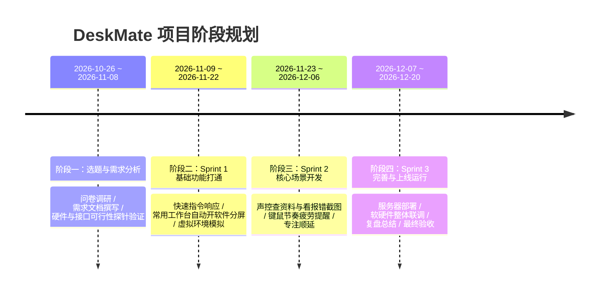
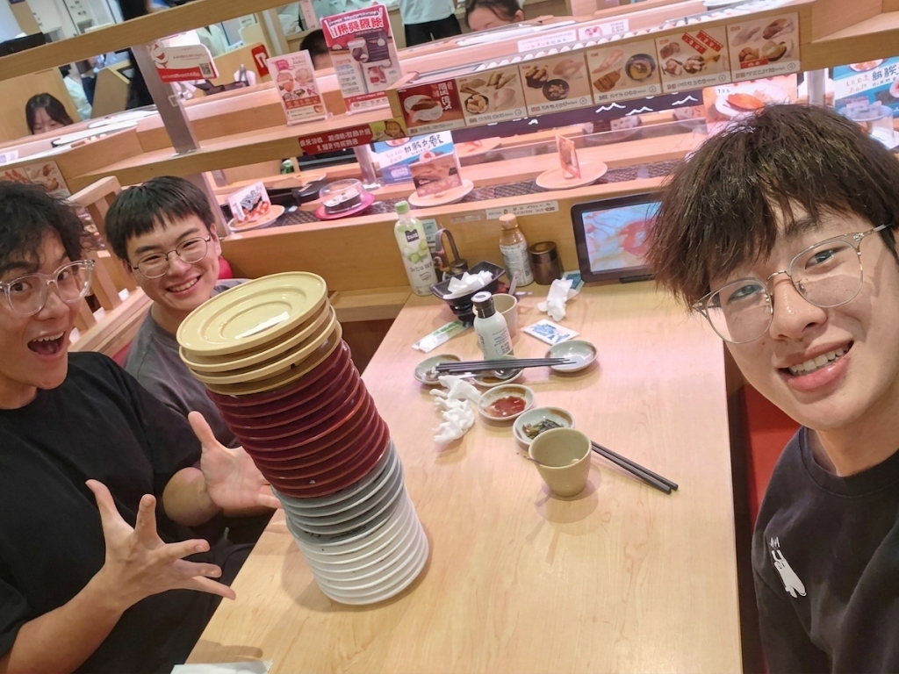
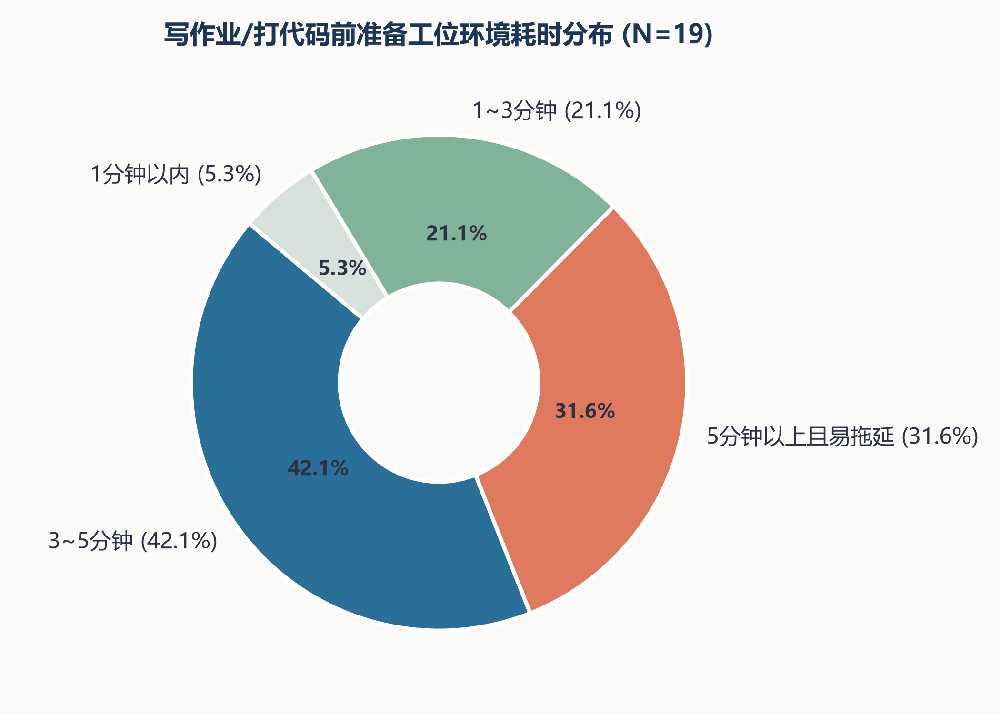
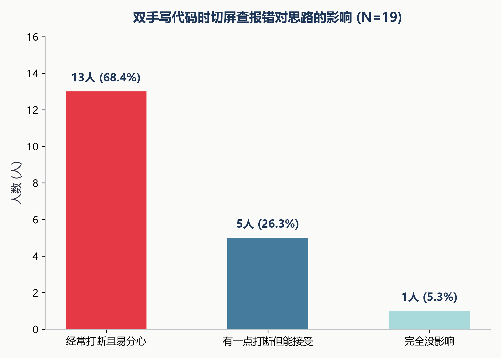
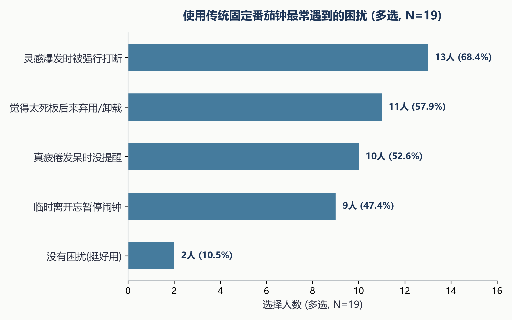
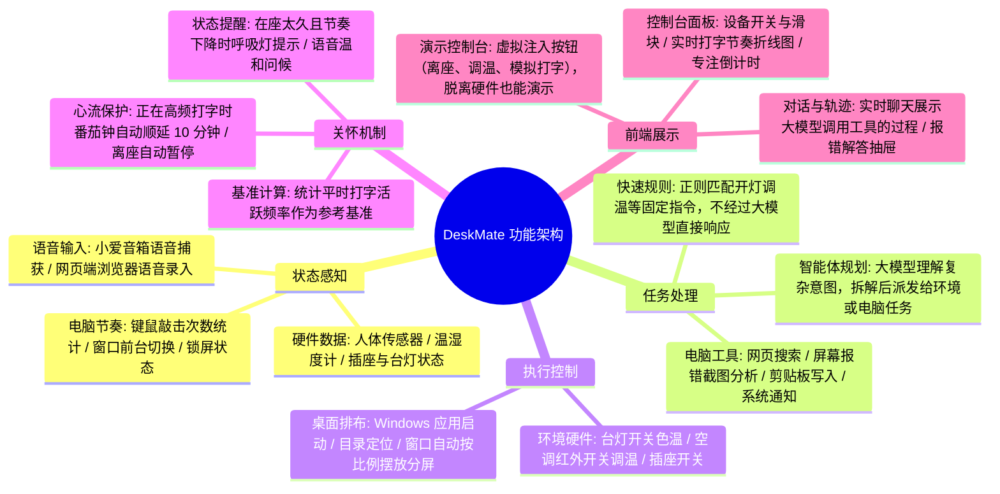
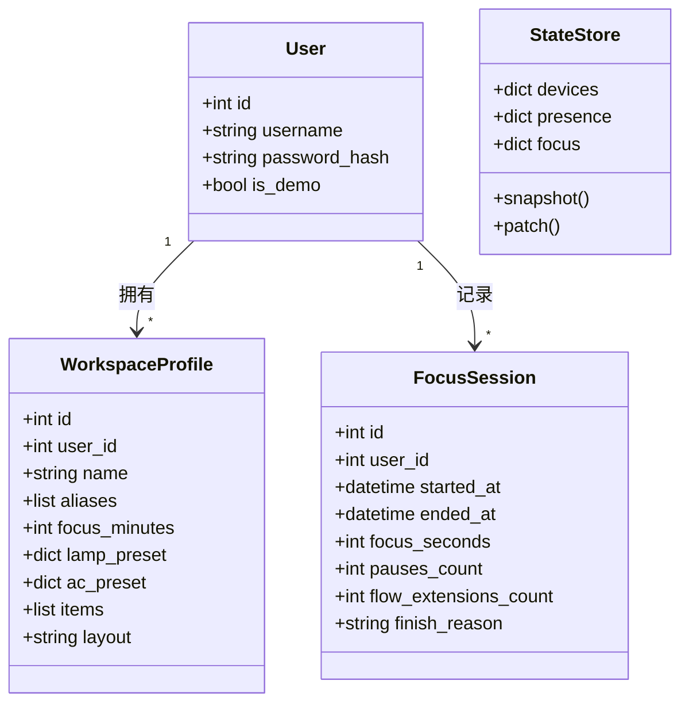

# 团队项目第一次作业：团队展示 + 选题报告 + 需求分析

| 作业所属课程            | [广东工业大学计算机学院 2024 级软件工程 (Class56-Grade2024-CS)](https://edu.cnblogs.com/campus/gdgy/Class56-Grade2024-CS/) |
| :---------------- | :--------------------------------------------------------------------------------------------------------- |
| **作业要求链接**        | [团队项目第一次作业 团队展示+选题报告+需求分析](https://www.cnblogs.com/zhangrongyue/)                                          |
| **作业的目标**         | 确定团队选题，完成真实需求调研，编写规范的需求分析文档，完成团队分工展示并做好后续开发规划                                                              |
| **团队理解的作业目标具体内容** | 找一个真正有用、贴近日常学习痛点的选题；做好前期的需求调研，把软件要做什么、前后端怎么配合、验收标准是什么写清楚；不盲目画大饼，实事求是地为接下来的实际开发和上线打好基础。                     |
| **团队名称**          | **OK**                                                                                                     |
| **团队成员学号-名字**     | **赵海翔**（3124004113） **何卓文**（3124004132） **吴与同**（3124004108）                                          |
| **GitHub 仓库地址**   | [IntZhx2 / IntZhx2 / deskmate](https://github.com/IntZhx2/IntZhx2/tree/main/deskmate)                      |

---

## 一、 团队展示

### 1. 队名：OK
- **项目定位**：一款在电脑桌前帮我们打理设备、操作电脑的桌面智能助手（DeskMate）。我们希望它能像个贴心副驾，坐下时一句话帮我们开灯、调空调、摆好作业窗口，写代码卡壳时能隔空声控查资料或看报错。

### 2. 团队项目规划及描述
项目采用敏捷开发的思路，共分为四个阶段推进：

### 3. 队员风采

| 队员姓名            | 学号         | 软工角色         | 个人性格             | 擅长技术                                                 | 兴趣爱好       | 负责模块与说明                                       |
| :-------------- | :--------- | :----------- | :--------------- | :--------------------------------------------------- | :--------- | :-------------------------------------------- |
| **赵海翔** （队长） | 3124004113 | **硬件与边缘端开发** | 踏实、动手能力强、注重把功能跑通 | Python、Windows 底层调用 (pywin32)、Home Assistant、物联网设备接入 | 数码产品、听歌、骑行 | 负责 Windows 本地客户端开发、接入宿舍米家台灯/传感器以及小爱音箱的语音收发联动。 |
| **何卓文**         | 3124004132 | **前端开发**     | 细心、喜欢琢磨交互、有耐心    | Vue 3、TypeScript、Element Plus、ECharts                | 羽毛球、滑雪     | 负责 Web 端的工位控制台、设备状态看板、敲击节奏折线图展示以及整体前端页面的交互逻辑。 |
| **吴与同**         | 3124004108 | **后端与智能体开发** | 逻辑严谨、条理清晰、沟通顺畅   | Python (FastAPI)、SQLModel/SQLite、大模型接口对接与任务规划        | 数码产品、看小说   | 负责后端服务搭建、多智能体任务拆解调度、虚拟边缘环境（用于脱离硬件自测）以及需求文档整理。 |

### 4. 团队首次合照

### 5. 团队项目的愿景（100 字左右）
> **DeskMate 愿景**：  
> 我们希望做出一款平时在书桌前写作业、敲代码时真正用得上的桌面助手。不用每次坐下都手忙脚乱地调灯、开空调、找网页和摆窗口，遇到问题时也能隔空问一句就得到结果。把繁琐的杂事交给系统打理，让我们能更轻松、更专注地投入到学习中。

---

## 二、 选题报告

### 1. 痛点：我们在工位写作业时的麻烦事
平时在宿舍或工位写作业、做课程设计时，我们发现经常被一些小事打断思路：
1. **进入状态前要做一堆琐事**：坐下来要开台灯调亮度、开空调、在电脑里一层层翻文件夹找作业工程、打开 IDE、开参考网页排窗口……往往折腾好几分钟还没正式开始，容易让人犯拖延；
2. **双手写代码时切屏很烦**：双手敲代码或者在纸上算题时，遇到报错或者记不清函数用法，必须停下来切到浏览器搜索，很容易顺手点开其他网页走神；
3. **普通番茄闹钟有点死板**：有时写得正顺手、思路刚打开，闹钟突然响了催你休息；有时学累了闷在房间发呆，反而没人提醒走动一下；
4. **设备有限没有摄像头**：我们桌前没有专门的摄像头，也不太喜欢摄像头一直开着对着自己，所以更倾向于用手里现成的普通传感器和打字节奏来做简单的状态判断。

### 2. 需求调研与数据
我们在发起了一份工位学习与编程习惯的小调查，共收集了 **19 份问卷**。样本主要覆盖了身边高频在电脑前写作业、打代码的同学，调研统计情况如下：

| 调研维度与题目 | 核心选项分布（样本数 N=19） | 占比 | 需求推导与结论分析 |
| :--- | :--- | :---: | :--- |
| **Q1: 写作业前准备工位环境耗时** | 3~5 分钟：8人 5 分钟以上且易拖延：6人 1~3 分钟：4人 1 分钟以内：1人 | 42.1% 31.6% 21.1% 5.3% | 超过 **73.7%** 的同学进入状态前需要花 3 分钟以上整理环境与软件窗口，容易诱发拖延，“一句话准备工位”切中痛点。 |
| **Q2: 双手写代码时切屏查报错的影响** | 经常打断且容易分心：13人 有一点打断但能接受：5人 完全没影响：1人 | **68.4%** 26.3% 5.3% | 近 **7 成** 同学强烈反映切屏查报错破坏思路，“隔空声控分析报错、代码直接写入剪贴板”能带来真正的体验提升。 |
| **Q3: 使用传统固定番茄钟最常遇到的困扰 (多选)** | 灵感爆发时被强行打断：13人 觉得太死板后来弃用：11人 真累了缺少主动提醒：10人 临时离开忘暂停闹钟：9人 | **68.4%** 57.9% 52.6% 47.4% | 固定番茄钟最大的痛点就是“不分时机硬性打断”，印证了系统设计“心流智能顺延”和“离座自动暂停”的必要性。 |

基于 19 份调研数据生成的对应统计分析图表如下：

**图 1：写作业/打代码前准备工位环境耗时分布**  

**图 2：双手写代码时切屏查报错对思路的影响**  

**图 3：使用传统固定番茄钟最常遇到的困扰（多选）**  

### 3. 产品定位与设计思路
- **产品定位**：**桌面智能助手（deskmate）**。
- **设计思路**：
  - **简单的操作走快速规则**：像开灯、关灯、调空调温度这些固定操作，直接走正则匹配快速执行，不用每次都去调用大模型，速度快且省流量；
  - **复杂的请求交给大模型规划**：像看报错截图、联网总结算法、整理代码这类开放任务，再交给大模型去理解和调用工具完成。

### 4. 三大核心场景
- **场景 1：一句话准备工位**  
  *我们对音箱说：“小爱同学，我要开始写软工作业了，帮我准备一下。”*  
  系统理解后会分头去办：台灯调到专注的暖白光（4000K）；室温太热时顺便开空调；电脑自动打开 VS Code 作业目录、打开需求文档网页，并把窗口按左右分屏规整排好。
- **场景 2：隔空声控电脑查资料与看报错**  
  *双手打字卡壳时：“小爱同学，帮我把桌面上那个报错截图分析一下。” / “帮我写个快速排序放到剪贴板。”*  
  后台自动把屏幕或桌面上的错误截图发给多模态大模型分析，音箱用简短的话播报原因；需要代码时，系统生成好代码后直接放进 Windows 剪贴板，右下角弹个提示，我们在编辑器里直接按 `Ctrl+V` 就能粘贴出来。
- **场景 3：温和的疲劳提醒与顺延**  
  因为桌前没有摄像头，系统主要看人体传感器是否在座、房间温湿度，以及键鼠最近一阵子的敲击频率。如果坐了很久并且打字明显变慢、房间又比较闷，台灯会柔和呼吸闪烁一下，音箱顺便提醒一句喝口水；如果番茄钟时间到了但我们键盘敲得很密集，系统会自动顺延 10 分钟，不硬性打断思路。

---

## 三、 需求分析文档

我们按照常见的软件工程需求文档结构，把项目的前端、后端、功能模块和验收要求梳理如下。

### 1. 需求迭代记录

|    版本    |     日期     |   修订人   | 说明                       |
| :------: | :--------: | :-----: | :----------------------- |
| **v0.1** | 2026-10-29 |   赵海翔   | 梳理初始 PRD，确定三大场景与手头硬件清单   |
| **v0.2** | 2026-10-31 |   吴与同   | 梳理后端接口与数据结构，设计前后端通信格式    |
| **v0.3** | 2026-11-02 | 吴与同、赵海翔 | 细化系统模块结构与 10 组基础验收用例     |
| **v1.0** | 2026-11-06 |   何卓文   | 补充问卷调研数据，更新前端页面结构与演示沙盒说明 |

### 2. 项目标志（Logo）

- **标志说明**：整体采用清新护眼的绿色背景，主体是一台带有微笑表情的电脑显示器，右侧台灯倾泻出温暖柔和的光芒，照亮屏幕与工位。寓意软硬件协同、安静温和地陪伴在桌面旁，让学习与工作更有温度。

### 3. 功能架构思维导图

### 4. 核心类与数据结构图

系统主要涉及用户、工作台配置、专注记录和运行状态这几大块：

### 5. 前端详细描述（由 何卓文 负责）

前端使用 **Vue 3 + Vite + TypeScript + Pinia + Element Plus + ECharts** 进行开发，采用响应式布局，支持电脑和手机屏幕查看：

1. **工位实时看板（`Dashboard.vue`）**：
   - **设备控制卡片**：可以直接拖动滑块调节台灯亮度和色温（2600K~5000K），点击按钮控制空调温度和插座开关；
   - **专注时钟与状态**：环形番茄钟倒计时，显示当前是学习、休息还是已暂停，顺延时会有醒目提示；
   - **键鼠活动趋势图（ECharts）**：用折线图显示每一分钟的打字/点击活跃度，直观看到自己什么时候敲得起劲、什么时候停下来发呆；
   - **环境数据**：展示温湿度计实时回传的温度和湿度数值。
2. **多智能体对话页面（`Chat.vue`）**：
   - 与智能体对话的界面，支持流式输出文字；
   - 包含**工具调用轨迹折叠面板**，能展开看大模型每一步是在查网页、看截图还是写剪贴板；
   - 右侧配有抽屉式结果展示栏，查出来的代码或者报错分析可以直接在右侧阅读，支持一键复制代码。
3. **演示沙盒界面（`Demo.vue`）**：
   - 专门用来脱离真实硬件也能自测体验的页面；
   - 提供了模拟入座、离座、锁屏、修改模拟打字速度、修改模拟室温的按钮和滑块，方便在没有带台灯和音箱的情况下检查前端逻辑是否正常。
4. **实时连接通信（`lib/realtime.ts`）**：
   - 通过 WebSocket 与后端建立长连接，后端状态一旦变化（比如灯被关了或者温度变了），前端界面在 100~200ms 内就会更新对应组件，不需要手动刷新网页。

### 6. 后端与边缘端详细描述（由 吴与同、赵海翔 负责）

后端主要由 **吴与同** 使用 **Python 3.11 + FastAPI + SQLModel** 开发，部署在云端或本地；边缘端由 **赵海翔** 在本地 Windows 电脑上运行。

1. **多智能体调度与任务拆解（吴与同负责）**：
   - 统一接入通义千问等兼容 OpenAI 接口的大模型；
   - 协调者负责听懂一整句话，如果是开灯这种简单事直接调设备；如果是复杂任务（如看报错、写代码），派发给电脑助手去执行；
   - 电脑任务限制最多思考和调用工具 6 步，防止大模型卡死或无限循环；
   - 不向大模型开放删除文件、关机等危险接口，报错截图仅在内存中调用视觉大模型处理，不长期保存图片文件。
2. **虚拟边缘环境 VirtualEdge（吴与同负责）**：
   - 后端内置了一套模拟环境。在真实设备不在线时，后端可以全真模拟台灯、插座、空调和键鼠事件；
   - 这样前端开发何卓文在写界面时，不用时刻连着物理音箱和台灯也能联调。
1. **Windows 边缘端本地控制（赵海翔负责）**：
   - 在本地 Windows 电脑上运行 Python 脚本，通过 `pywin32` 实现自动启动 VS Code、浏览器并把窗口排好；
   - 通过 `pynput` 统计每分钟敲击了多少次键盘、点了多少下鼠标（**只记录数字，绝对不记录按键内容**）；
   - 在本地通过 Docker 运行 Home Assistant 接入米家设备，通过小爱音箱的云端对话接口抓取语音原话并发送播报。

### 7. 系统功能清单（P0 阶段基础功能）

| 编号 | 功能名称 | 负责人 | 边缘现场端实现 | 后端平台实现 | 前端界面实现 |
| :--- | :--- | :---: | :--- | :--- | :--- |
| **F-01** | 工作台一句话唤醒 | 赵海翔 / 吴与同 | 启动软件并排布分屏窗口 | 解析意图，并发下发环境和电脑动作 | 工作台增删改查与布局配置 |
| **F-02** | 隔空声控电脑查资料 | 赵海翔 / 吴与同 | 抓取桌面截图、写入系统剪贴板 | 调度大模型看图、搜网和写代码 | 折叠展示思考步骤，结果抽屉展示 |
| **F-03** | 疲劳温和提醒 | 吴与同 / 何卓文 | 统计每分钟键鼠敲击数 | 结合时长、节奏和温湿度打分 | 实时折线图展示与状态标签 |
| **F-04** | 心流顺延保护 | 吴与同 / 何卓文 | 检测番茄钟结束前键鼠活跃 | 打字活跃时自动顺延 10 分钟 | 界面显示“顺延中”提示 |
| **F-05** | 在座与离座感应 | 赵海翔 / 吴与同 | 上报人体移动信号与锁屏事件 | 离座暂停计时，离座久了关灯关空调 | 倒计时对应暂停与状态显示 |
| **F-06** | 专注番茄钟 | 吴与同 / 何卓文 | 到点触发音箱提示 | 维护学习/休息状态机与时长记录 | 环形倒计时组件与操作按钮 |
| **F-07** | 设备联动控制 | 赵海翔 / 吴与同 | 控制台灯亮度色温、空调红外开关 | 维护当前设备状态与规则 | 设备卡片开关与控制滑块 |
| **F-08** | 语音交互通道 | 赵海翔 / 吴与同 | 捕获小爱语音并执行 TTS 播报 | 快速指令直接匹配，复杂指令调模型 | 支持网页端浏览器语音录入 |
| **F-09** | 实时状态控制台 | 何卓文 | 上报本地设备状态 | WebSocket 合并广播最新状态 | 响应式工位看板 |
| **F-12** | 演示模式 | 吴与同 / 何卓文 | 离线时切换内存模拟 | 隔离演示账号，支持事件注入 | 演示控制台与滑块操作界面 |

### 8. 验收标准（不画大饼，实事求是）

为了期末最终验收时能对照检查，我们制定了具体的测试用例，并在文档中清楚区分了“已通过模拟验证”和“待真机端到端验收”：

- **用例 A01（工作台唤醒）**：
  - *输入*：“我要开始写软工作业了，帮我准备一下。”
  - *验收指标*：说完后 3 秒内台灯亮起专注光；12 秒内目标软件（如 VS Code）和网页打开并排好；如果某一个网页打不开，不影响其他软件打开。
- **用例 A03（空调调温）**：
  - *输入*：“空调调到 25 度”；
  - *验收指标*：3 秒内下发红外指令；如果故意说“空调调到 99 度”，系统能判断出数值不合理并拒绝执行。
- **用例 A04（看报错截图）**：
  - *输入*：“帮我把桌面上那个报错截图分析一下。”
  - *验收指标*：15 秒内音箱口头说出报错原因，网页端显示详细分析；后台内存处理完后不把用户截图留在硬盘里。
- **用例 A06（声控写代码到剪贴板）**：
  - *输入*：“帮我写个快速排序放到剪贴板。”
  - *验收指标*：完成后电脑右下角弹提示，在编辑器里按 `Ctrl+V` 能直接粘出可用的快排代码。
- **用例 A08（锁屏离座暂停）**：
  - *操作*：按下 `Win + L` 锁屏；
  - *验收指标*：3 秒内番茄钟自动暂停，台灯切成微弱暖光；解锁回来后自动恢复剩下的时间继续计时。

> 📄 **文档链接**：我们把完整的需求说明书整理到了文档，可查看工程目录下的 [`docs/assignment_b/SRS.md`](file:///d:/Code/IntZhx2/deskmate/docs/assignment_b/SRS.md)。

---

## 四、 现阶段技术进展说明

虽然这次作业主要侧重在选题和需求分析，我们在开题期间已经把最容易踩坑的链路提前做了一轮验证（Spike）：

1. **硬件端（赵海翔）**：在本地电脑上跑通了 Home Assistant，米家台灯、温湿度计和人体传感器已经能通过代码控制，也成功在 1 秒左右从小爱音箱抓取到了我们说的原话，能正常给空调发红外指令。
2. **后端（吴与同）**：搭建了 FastAPI 后端基础框架，写好了多智能体分发逻辑，并且做好了 `VirtualEdge` 虚拟环境，这样即使不连真实硬件，系统也能在内存里模拟设备跑通所有流程。
3. **前端（何卓文）**：搭建好了 Vue 3 工程骨架，把实时看板、设备调光滑块、番茄钟倒计时和演示沙盒页面做出了原型，能正常和后端长连接通信。
