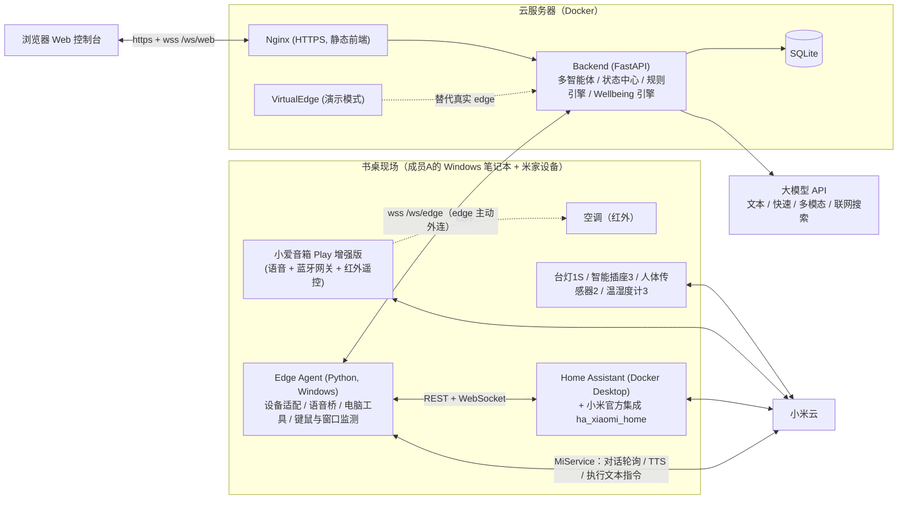
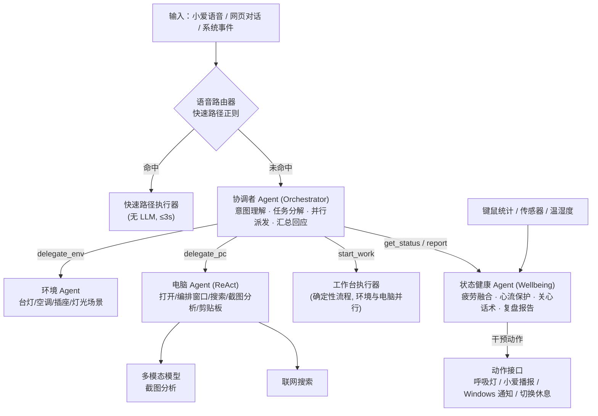
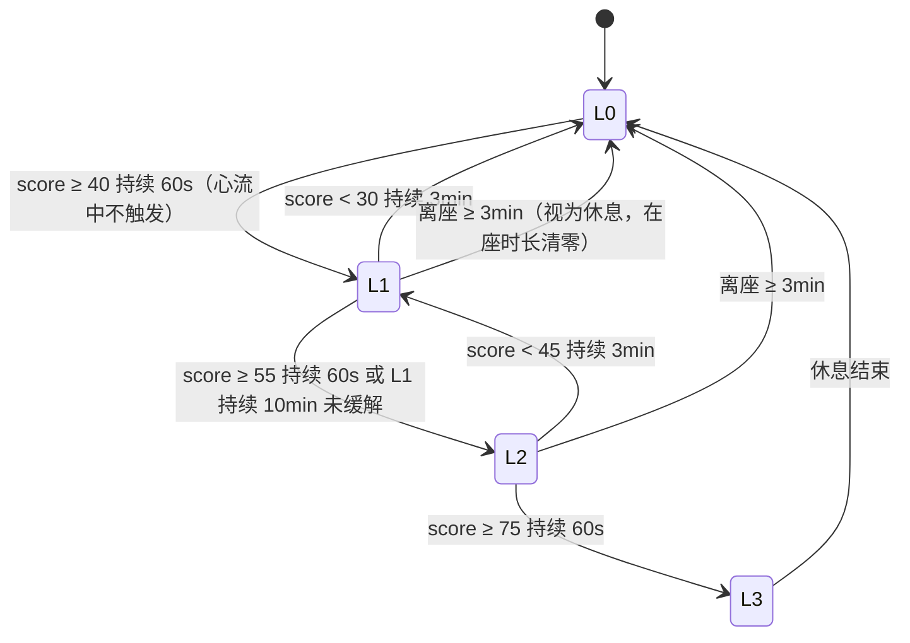
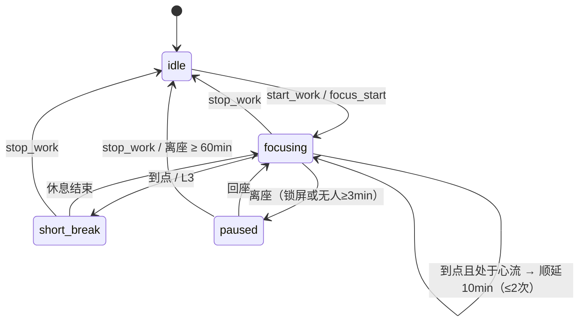
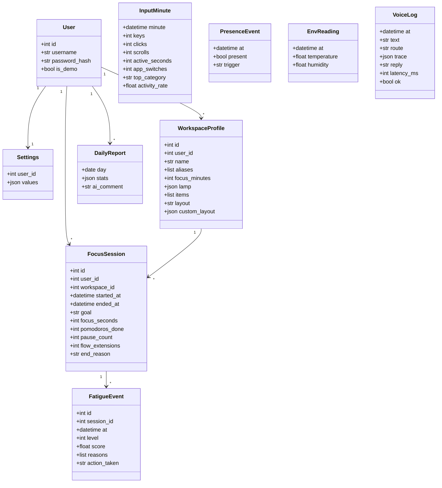
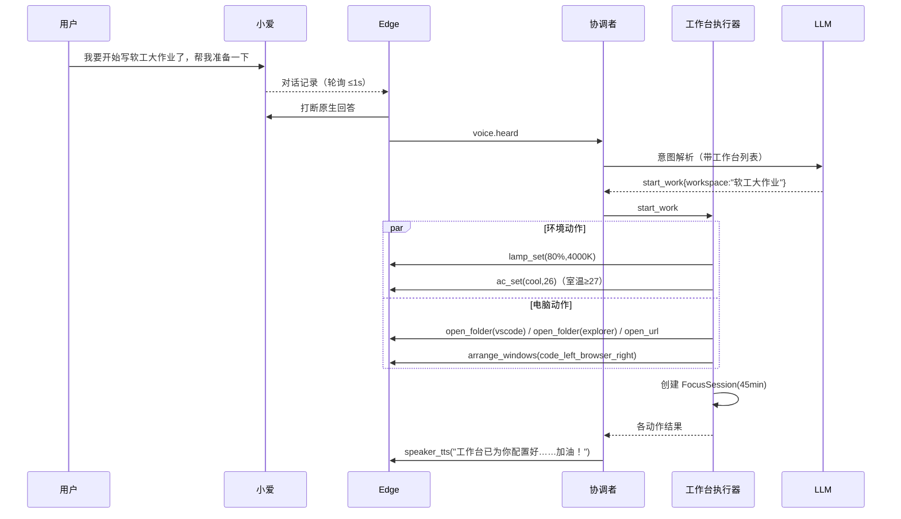
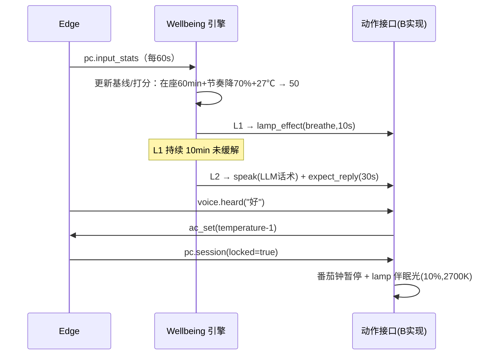

# ARCHITECTURE —— 系统架构（v0.2）

## 1. 总体架构



**关键设计决策**
1. **Edge 主动外连云端 WebSocket**：宿舍无公网 IP，无需内网穿透。
2. **Home Assistant 做设备抽象层**：BLE 传感器只能经网关上小米云，小米官方 HA 集成统一提供状态推送与控制。HA 不可用时降级为 `mijiaAPI`（只改 edge 适配层）。
3. **空调走小爱红外**：小爱 Play 增强版自带红外遥控，空调在米家中是"红外虚拟设备"。首选方案是通过小爱"执行文本指令（静默）"下发自然语言（"把空调调到 26 度"），因为这一路径对所有红外设备通用；若 HA 能直接暴露该红外空调实体，则改用 HA 调用。红外无状态回传 → 后端维护"推测状态"。
4. **小爱语音输入用"对话记录轮询"**（参考 xiaogpt / mi-gpt / MiService），多轮确认通过"期待回复窗口"实现；兜底网页语音输入。
5. **大脑只在后端**：edge 只负责"感知上报 + 执行工具"，不做决策。
6. **工具由 edge 动态注册**：edge 连接时上报 ToolSpec（JSON Schema），后端按"所属 Agent"分组注册（沿用 TravelAgent 的 MCP 工具思想）。
7. **疲劳检测不用摄像头**：用"在座时长 + 键鼠节奏相对个人基线 + 发呆 + 环境 + 时段"多源融合，个人基线让判断因人而异，并能识别"心流"反向保护。
8. **演示模式**：VirtualEdge 与真实 edge 协议完全一致，满足"上线供老师检查"和 B/C 无硬件开发。

## 2. 多智能体设计（答辩重点）



| Agent | 实现方式 | 模型 | 工具 |
|---|---|---|---|
| 协调者 | function calling，单轮可并行发出多个工具调用（`asyncio.gather` 执行） | `LLM_MODEL` | `start_work`、`stop_work`、`delegate_env`、`delegate_pc`、`get_status`、`get_today_summary`、`set_reminder`、`save_workspace`(P1) |
| 环境 Agent | 简单请求走规则映射；复杂请求（"灯光弄温馨点""有点闷"）用快速模型选工具 | `LLM_FAST_MODEL` | `lamp_set`、`lamp_effect`、`ac_set`、`plug_set` |
| 电脑 Agent | ReAct，最多 6 步 | `LLM_MODEL` + `LLM_VL_MODEL` | edge 电脑工具 + 后端 `web_search`、`analyze_image` |
| 状态健康 Agent | **规则打分（确定性）+ 快速模型生成话术与报告点评** | `LLM_FAST_MODEL` | 通过动作接口执行干预（CONTRACTS §8） |

设计原则：**需要可靠的地方用确定性代码，需要理解与表达的地方用大模型**。工作台执行、疲劳打分、规则联动是确定性的；意图理解、开放任务规划、话术、复盘由 LLM 完成。

## 3. 后端模块与所有权

```
backend/app/
  main.py config.py db.py clock.py          (B)
  schemas/contracts.py                      (B) 契约 pydantic 模型
  ws/ edge_hub.py web_hub.py envelope.py    (B)
  api/ ...                                  (B) 除 reports/timeline 外的 REST
  engine/ state_store.py presence.py rules.py focus.py scheduler.py   (B)
  agent/ llm.py orchestrator.py env_agent.py pc_agent.py workspace_exec.py
         voice_router.py tools.py search.py vision.py prompts.py      (B)
  sim/virtual_edge.py                       (B)
  wellbeing/                                (C)
    models.py        InputMinute / FatigueEvent / FlowExtension / DailyReport 表
    baseline.py      个人基线
    fatigue.py       疲劳打分与等级状态机
    flow.py          心流保护
    engine.py        WellbeingEngine（实现 CONTRACTS §8 接口）
    copywriter.py    关心话术（LLM + 模板兜底）
    report.py        日报/周报统计与 AI 点评
    router.py        /api/reports/* 与 /api/timeline
```

## 4. 疲劳等级状态机



## 5. 专注会话状态机



## 6. 数据模型（需求文档类图）



运行时对象（不落库）：`DeviceState`、`PresenceState`、`FocusState`、`FatigueState`、`PcActivity`，字段见 CONTRACTS §2。

## 7. 典型时序：场景 1



## 8. 典型时序：场景 3



## 9. 部署

- 云服务器 2C2G；`deploy/docker-compose.yml`：`backend` + `nginx`（托管 `frontend/dist`，反代 `/api`、`/ws`，SSE 关闭缓冲）。
- HTTPS 推荐（JWT 安全、wss）。国内域名需 ICP 备案（1~3 周），第一周就办；来不及用香港区服务器。
- 现场：Windows 笔记本运行 Docker Desktop（HA）+ `python -m deskmate_edge`。
