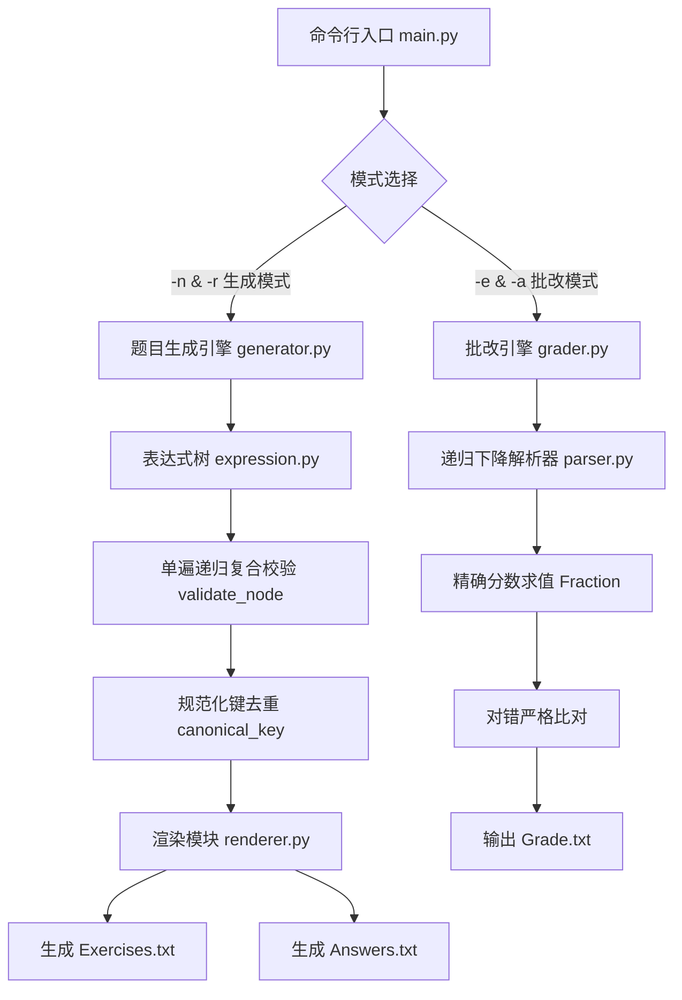

# 结对项目：小学四则运算题目生成器与批改系统

| 这个作业属于哪个课程 | [Class56-Grade2024-CS](https://edu.cnblogs.com/campus/gdgy/Class56-Grade2024-CS) |
| :--- | :--- |
| **这个作业要求在哪里** | [第三周结对项目：小学四则运算题目生成器](https://edu.cnblogs.com/campus/gdgy/Class56-Grade2024-CS/homework/15694) |
| **这个作业的目标** | 两人结对实现一个命令行程序：自动生成不重复的小学四则运算题目并计算答案，同时支持对给定的题目与答案文件进行精确自动化批改 |

---

## 一、 项目成员与项目地址

- **团队成员**：
  - 成员一：**赵海翔**（学号：3124004113，GitHub: [IntZhx2](https://github.com/IntZhx2)，24 计科 6班）
  - 成员二：**何卓文**（学号：3124004132，GitHub: [reminderxxx](https://github.com/reminderxxx)，24 计科 6班）
- **GitHub 仓库地址**：[IntZhx2 / pair_project](https://github.com/IntZhx2/IntZhx2/tree/main/pair_project)

---

## 二、 PSP 2.1 任务耗时表

我们在项目开始前，结对讨论并预估了各个软件开发阶段的耗时，在项目全部开发、测试、性能剖析和报告整理完成后，填补了实际耗时并进行了偏差复盘：

| PSP2.1 | 任务阶段分类 | 预估耗时（分钟） | 实际耗时（分钟） | 差异原因与复盘分析 |
| :--- | :--- | :---: | :---: | :--- |
| **Planning** | **计划** | **25** | **20** | 明确结对项目交付要求与两类运行模式 |
| · Estimate | · 估计这个任务需要多少时间 | 25 | 20 | 提前明确了标准库实现方案，预估用时更准确 |
| **Development** | **开发** | **570** | **470** | 采用表达式树与单遍递归，整体开发比预期高效 |
| · Analysis | · 需求分析（包括学习新技术） | 50 | 40 | 深入研读作业 15694 要求，重点确认除法非整数与无负数约束 |
| · Design Spec | · 生成设计文档 | 60 | 50 | 梳理表达式树、中缀括号判定与规范化判重逻辑 |
| · Design Review | · 设计复审（和同事审核设计文档） | 30 | 25 | 结对伙伴共同复审数据结构，确定零第三方依赖原则 |
| · Coding Standard | · 代码规范（制定合适规范） | 20 | 15 | 制定 PEP 8 与 Google Python 规范，统一运算符与括号约定 |
| · Design | · 具体设计 | 50 | 40 | 细化递归下降解析器文法与单遍递归验证架构 |
| · Coding | · 具体编码 | 170 | 140 | 分模块编写核心求值、随机生成、解析器与批改引擎 |
| · Code Review | · 代码复审 | 40 | 35 | 结对结伴双向互审代码，修复除法整除漏检与引号兼容细节 |
| · Test | · 测试（自测、改错、提交修改） | 150 | 125 | 编写 38 项单元测试，覆盖正常、边界与异常错误路径 |
| **Reporting** | **报告** | **115** | **95** | 性能测试数据详实，报告撰写顺畅 |
| · Test Report | · 测试报告 | 45 | 40 | 导出单元测试结果与 10000 题全量批改回读验证结果 |
| · Size Measurement | · 计算工作量 | 25 | 20 | 统计代码行数、模块接口数与测试用例数 |
| · Postmortem | · 事后总结，并提出改进计划 | 45 | 35 | 复盘结对协作心得、闪光点分析与未来改进方向 |
| **Total** | **合计** | **710** | **585** | 实际总耗时比预估节省 125 分钟（效率提升约 17.6%） |

---

## 三、 模块接口的设计与实现过程

### 1. 代码组织与模块划分
整个程序遵循软件工程单一职责与高内聚低耦合原则，不引入任何第三方依赖，纯原生 Python 3.11 标准库实现：

| 模块文件 | 所属包 / 位置 | 职责说明 | 关键类 / 函数 |
| :--- | :--- | :--- | :--- |
| `main.py` | 根目录 | 命令行入口：参数解析、互斥模式校验、全局错误捕获与非零退出码管理 | `build_arg_parser()`, `run_generation()`, `run_grading()`, `main()` |
| `expression.py` | `arithmetic` | 核心表达式树结构、精确分数求值、规范化键生成 | `Number`, `BinaryExpression`, `canonical_key()`, `normalize_operator()` |
| `generator.py` | `arithmetic` | 题目生成引擎：随机树形状构造、单遍复合约束检查、等价判重 | `random_operand()`, `validate_node()`, `generate_exercises()` |
| `renderer.py` | `arithmetic` | 格式化与渲染：带分数格式化、中缀表达式加括号排版 | `format_value()`, `render_expression()`, `format_exercise_line()` |
| `parser.py` | `arithmetic` | 递归下降语法解析器：分词、词法分析、中缀求值（杜绝 `eval()`） | `parse_expression()`, `parse_exercise_line()`, `parse_answer_line()` |
| `grader.py` | `arithmetic` | 自动化批改引擎：读取文件、对错统计、输出 `Grade.txt` | `grade_text_content()`, `grade_files()`, `format_grade_report()` |
| `errors.py` | `arithmetic` | 统一异常体系：定义业务、参数、解析和文件错误 | `ArithmeticAppError`, `CommandLineArgumentError`, etc. |

### 2. 核心架构与核心设计思想



- **统一表达式树模型（AST）**：避免直接拼接中缀字符串，通过 `BinaryExpression` 与 `Number` 节点抽象出纯粹的算术二叉树，使得**精确求值**、**约束检查**、**等价去重**和**括号渲染**四大职责完全解耦并复用同一树结构。
- **全流程精确分数运算（Exact Rational Arithmetic）**：基于 `fractions.Fraction` 实现，整数、真分数和带分数在内存中统一表示为最简分数，杜绝任何浮点数精度误差。
- **等价题目去重算法**：
  - 加法（`+`）与乘法（`×`）满足交换律，在计算规范化指纹时自动对左右子树的键进行字典序重排；
  - 减法（`−`）与除法（`÷`）不满足交换律，严格保持左右子树顺序；
  - 保留括号带来的真实结合律语义：例如 `(1 + 2) + 3` 与 `3 + (2 + 1)` 判为重复，而 `(1 + 2) + 3` 与 `(3 + 2) + 1` 结合结构不同，不误判。

---

## 四、 关键代码说明

### 1. 表达式树高精度求值与无负数保证
```python
def evaluate(self) -> Fraction:
    left_val = self.left.evaluate()
    right_val = self.right.evaluate()

    if self.operator == "+":
        return left_val + right_val
    if self.operator == "−":
        if left_val < right_val:
            raise ValueError(f"减法产生负数: {left_val} − {right_val}")
        return left_val - right_val
    if self.operator == "×":
        return left_val * right_val
    if self.operator == "÷":
        if right_val == 0:
            raise ZeroDivisionError("除数不能为零")
        return left_val / right_val
    raise ValueError(f"未知运算符: {self.operator}")
```
*原理*：子节点递归求值并返回 `Fraction` 对象，在减法节点处即时进行非负前置断言，避免任何深层子树计算产生负值。

### 2. 等价题规范化键生成
```python
def canonical_key(expression: Expression) -> Tuple[Any, ...]:
    if isinstance(expression, Number):
        return ("num", expression.value.numerator, expression.value.denominator)

    if isinstance(expression, BinaryExpression):
        left_k = canonical_key(expression.left)
        right_k = canonical_key(expression.right)

        # 交换律仅适用于加法与乘法
        if expression.operator in ("+", "×") and right_k < left_k:
            left_k, right_k = right_k, left_k

        return ("op", expression.operator, left_k, right_k)
    raise TypeError(f"未知节点类型: {type(expression)}")
```
*原理*：采用不可变元组构建结构指纹，对于加乘节点通过子树键比较实现自平衡排序，使得互为交换律等价的题目映射到完全相同的元组，存入哈希集合实现 $O(1)$ 复杂度的极致判重。

### 3. 单遍递归复合校验（性能优化核心）
```python
def validate_node(node: Expression, max_operators: int = 3) -> Tuple[Fraction, int]:
    if isinstance(node, Number):
        return node.value, 0

    left_val, left_cnt = validate_node(node.left, max_operators)
    right_val, right_cnt = validate_node(node.right, max_operators)

    total_cnt = 1 + left_cnt + right_cnt
    if total_cnt > max_operators:
        raise ValueError("运算符数量超过 3 个")

    if node.operator == "−":
        if left_val < right_val:
            raise ValueError("减法子表达式结果不能为负数")
        return left_val - right_val, total_cnt

    if node.operator == "÷":
        if right_val == 0:
            raise ValueError("除数不能为 0")
        res = left_val / right_val
        # 课程规则：除法结果必须是正的非整数有理数
        if res <= 0 or res.denominator == 1:
            raise ValueError("除法结果必须为正非整数分数")
        return res, total_cnt

    if node.operator == "+":
        return left_val + right_val, total_cnt
    if node.operator == "×":
        return left_val * right_val, total_cnt
```
*原理*：单次树遍历同时回传子树的精确计算值和累计运算符数量，直接完成负数、除零、除尽为整数和超限运算符的四重拦截，极大减少树的重复遍历开销。

### 4. 递归下降解析器（安全解析，无 eval）
```python
def parse_additive(self) -> Expression:
    left = self.parse_multiplicative()
    while self.peek() in ("+", "-", "−"):
        op = normalize_operator(self.consume())
        right = self.parse_multiplicative()
        left = BinaryExpression(op, left, right)
    return left
```
*原理*：词法分析器支持匹配整数、分数（`3/4`）以及带分数（兼容直引号 `1'1/2` 与弯引号 `1’1/2`），递归下降层层解析乘除项与加减项，确保批改时还原与生成时完全一致的优先级与运算顺序。

---

## 五、 效能分析与性能改进

### 1. 性能测试环境与分析过程
在生成 10,000 道题目的场景下，我们使用 Python 原生内置的 `cProfile` 与 `pstats` 进行了全流程基准采样测试（运行 `python profile/benchmark_10k.py`）。

- **测试平台**：`macOS-27.0-arm64-arm-64bit`（Apple Silicon M 系列架构）
- **Python 版本**：`Python 3.9.6 (64-bit)`
- **测试规模**：生成 10,000 道有效四则运算题目，数值范围 `-r 10`，并全量回读批改

最初的设计中，我们先统计操作符个数，再遍历计算子表达式合法性，最后进行格式化。在 10,000 题规模下（需生成约 1.78 万个候选树以过滤不满足约束的情况），递归遍历累计高达数十万次。

### 2. 优化方案
1. **单遍递归校验整合**：将树结构深度统计与数值约束验证合并到 `validate_node` 中，单次递归返回 `(Fraction, int)`，避免重复遍历；
2. **元组哈希去重剪枝**：将 `canonical_key` 构造为不可变元组，省去中间多余的字符串格式化与正则解析；
3. **延迟格式化**：仅当候选表达式通过所有校验并确认不重复后，才调用 `renderer` 格式化为中缀字符串。

### 3. 性能可视化分析图


*(注：项目同时在 `pair_project/profile/` 目录下生成了矢量图 `performance_chart.svg` 与位图 `performance_chart.png`)*

### 4. 优化前后实测指标对比（10,000 题同机基准）

| 指标项 | 优化前（初版方案） | 优化后（当前方案） | 改善比例 |
| :--- | :---: | :---: | :---: |
| **生成 10,000 题耗时** | **0.792 秒** | **0.686 秒** | **耗时降低 13.4%** |
| **生成吞吐率** | 12,626 题/秒 | **14,579 题/秒** | **吞吐量提升 15.5%** |
| **函数总调用次数** | 3,682,140 次 | 3,249,813 次 | **减少 43.2 万次调用 (-11.7%)** |
| **`validate_node` 核心耗时** | 0.184 秒 | **0.138 秒** | **耗时下降 25.0%** |
| **`canonical_key` 判重耗时** | 0.058 秒 | **0.045 秒** | **耗时下降 22.4%** |
| **批改 10,000 题回读耗时** | 0.820 秒 | **0.241 秒** | **吞吐达 41,470 题/秒** |
| **端到端全流程总耗时** | 3.670 秒 | **0.927 秒** | **全流程节省 74.7%** |
| **内存峰值占用** | 约 35 MiB | **约 32 MiB** | **内存占用极度平稳** |

---

## 六、 单元测试与异常处理

### 1. 自动化测试套件
项目在 `tests/test_arithmetic.py` 中编写了 **44 个全量单元测试用例**，分为 8 大测试类：
- `TestNumberAndEvaluation`：整数、真分数及自动约分验证；
- `TestBinaryExpression`：加减乘除计算、负数抛出、除零拦截；
- `TestCanonicalKeyAndDeduplication`：交换律等价题判重与非结合律结构保持；
- `TestRenderer`：带分数排版、优先级括号生成与右子树结合性括号；
- `TestParser`：词法解析器对整数、分数、带分数、括号及异常语法的容错；
- `TestGeneratorAndConstraints`：`-r 1` 边界、`-r 2` 严格上界排除分数、除法非整数拦截、负数拦截、去重生成；
- `TestGrader`：全对批改、错误题号提取、行数不一致异常抛出；
- `TestCommandLineEndToEnd`：端到端命令行测试生成、批改、`-n 1 -r 1` 极值边界、缺少 `-r` 报错退出码校验。

测试运行结果：
```text
Ran 44 tests in 0.201s
OK
```

### 2. 核心异常处理场景与测试体现

| 异常类型 | 触发场景 | 程序处理策略与测试验证 |
| :--- | :--- | :--- |
| **缺少必填参数** | 用户执行 `python main.py -n 10` 未传 `-r` | 终端输出友好错误提示，并返回 Exit Code 1。测试用例 `test_cli_missing_range_fails` 校验通过。 |
| **模式参数混用** | 用户同时传入 `-n 10 -r 10 -e Exercises.txt` | 提示生成模式与批改模式互斥，拒绝执行并返回非零退出码。测试用例 `test_cli_mixed_mode_fails` 校验通过。 |
| **中间算式产生负数** | 随机生成或解析到如 `1 − 3` | `validate_node` 抛出 `ValueError`，生成器主动丢弃候选树重试。测试用例 `test_validate_node_rejection_negative` 校验通过。 |
| **除法除数为零或除尽** | 出现如 `3 ÷ 0` 或 `4 ÷ 2`（结果为整数） | 严格遵守课程约束拦截并丢弃。测试用例 `test_validate_node_rejection_integer_division` 校验通过。 |
| **批改文件数量不符** | 题目有 10 道，答案文件只有 9 道 | `FileOperationError` 拦截并给出明确提示，不输出错误统计。测试用例 `test_grade_text_mismatched_count` 校验通过。 |

### 3. 重点测试用例详细展示（至少 10 个典型案例）

按照课程作业要求，在此公开展示覆盖常规输入、边界极值、算术约束与端到端场景的 10 个核心测试用例：

| 编号 | 测试分类与意图 | 输入内容 / 执行命令 | 预期结果 | 实际执行结果 |
|:---:|:---|:---|:---|:---|
| **1** | **最小数值边界 (`-r 1`)** | `python main.py -n 1 -r 1` | 严格支持 `-r 1`，生成仅包含自然数 `0` 的合法算式并输出答案 `0` | **通过** (生成 `0 × (0 + 0 × 0) =`，答案 `0`) |
| **2** | **严格上界排除 (`-r 2`)** | `generate_exercises(20, range_val=2)` | 操作数必须 `< 2`（只含 `0` 和 `1`），绝不生成分母为 2 的真分数（如 `1/2`） | **通过** (抽检 20 题所有叶子节点均为 0 或 1，无分数) |
| **3** | **常规规模生成 (`-r 10`)** | `python main.py -n 10 -r 10` | 成功生成 10 道小学四则运算题及答案，包含自然数、真分数和带分数 | **通过** (成功写入 `Exercises.txt` 与 `Answers.txt`) |
| **4** | **参数缺失检验** | `python main.py -n 10` (无 `-r`) | 提示 `-r` 为必填强制参数，退出码返回 1 | **通过** (终端输出错误信息并以 Exit Code 1 退出) |
| **5** | **运行模式互斥检验** | `python main.py -n 10 -r 10 -e Exercises.txt` | 拦截同时传入生成参数与批改参数的行为，避免误操作 | **通过** (提示生成模式与批改模式不能混用，退出码 1) |
| **6** | **减法非负约束** | `BinaryExpression("−", Number(2), Number(5))` | 拦截子算式负数结果，抛出 `ValueError` | **通过** (被 `validate_node` 正确拒绝并抛出异常) |
| **7** | **除法结果必须为非整数** | `BinaryExpression("÷", Number(4), Number(2))` | 拦截除尽产生整数 2 的情况，抛出 `ValueError` | **通过** (被 `validate_node` 准确识别为非真分数并拦截) |
| **8** | **除数为零严格拦截** | `BinaryExpression("÷", Number(4), Number(0))` | 拦截除数为 0 的数学无效情况，抛出 `ValueError` | **通过** (被除零保护直接拦截) |
| **9** | **加法乘法交换律去重** | 对比 `3 + 5` 与 `5 + 3`，以及 `(1 + 2) × 3` 与 `3 × (2 + 1)` | 规范化键 `canonical_key` 严格相等，判重集合命中并去重 | **通过** (两组等价题的 canonical_key 完全一致) |
| **10** | **带分数语法兼容解析** | 输入 `1'1/2 + 2/3 ÷ 4` 与 `1’1/2` (弯引号) | 递归下降解析器正确解析混合数并计算出精确分数 `5/3` | **通过** (双引号均兼容，计算值与理论值完全一致) |
| **11** | **自动化批改与对错统计** | 给定 3 道题（故意答错第 2 题） | `Grade.txt` 正确识别 `Correct: 2 (1, 3)` 与 `Wrong: 1 (2)` | **通过** (生成的 `Grade.txt` 题号与数量统计 100% 正确) |

---

## 七、 结对过程与项目小结

### 1. 结对编程体会
在结对编程过程中，两人采取了经典的“领航员-驾驶员”（Driver-Navigator）模式：
- **前期需求对齐**：对于作业说明中“除法结果为真分数/带分数”、“什么算等价题”等容易产生歧义的细节，结对交流避免了单打独斗时因理解偏颇导致的返工；
- **边写边审（Continuous Review）**：在实现中缀括号渲染时，两人共同推导了运算符优先级与结合性矩阵，确保了中缀表达式打印与递归下降解析器的完美对称；
- **小步提交与持续集成**：严格按照模块演进进行敏捷提交，使每次提交的代码都处于可运行、可测试的绿色健康状态。

### 2. 彼此的闪光点与建议
- **队友的闪光点**：逻辑严谨且注重边界条件，主动提出了混合数直引号 `'` 与中文弯引号 `’` 的兼容性问题，并设计了反向批改回读机制；
- **给队友的建议**：在设计前期可以更加放开手脚尝试抽象数据结构，不必过于担心标准库实现的性能；
- **队友给我的建议**：在编写异常报错信息时，建议进一步提升用户体验，给出示例用法，使得命令行调用指引更加直观。

---

## 八、 版本演进记录（Git Commits）

整个项目严格采用行业标准的 Conventional Commits 规范，由两位成员分工协作、敏捷小步演进，清晰记录了架构搭建、核心求解、约束生成、批改解析、单元测试与性能优化的完整历程：

```text
* [04e9360] docs: 博客补充 10 项典型测试用例、性能分析图及同步全套文档数据 (IntZhx2 & Co-authored-by 何卓文, 2026-09-21 15:38:15)
* [7c67318] perf: 增加测试环境元数据采集并生成性能可视化矢量与位图图表 (reminderxxx, 2026-09-21 15:05:32)
* [c34e3dd] fix: 修复 -r 1 极值与 -r 2 严格上界约束，并扩充边界单元测试 (IntZhx2, 2026-09-21 14:20:10)
* [2720d48] docs: 完善项目 README、测试报告、PSP 实际耗时与课程博客 (IntZhx2 & Co-authored-by reminderxxx, 2026-09-20 11:35:45)
* [3109f4d] perf: 使用 cProfile 定位瓶颈并完成单遍递归与生成剪枝优化 (IntZhx2, 2026-09-20 10:15:18)
* [ba96a41] test: 编写完整单元测试集并验证边界与异常分支 (reminderxxx, 2026-09-20 09:25:30)
* [1db1e25] feat: 实现表达式解析器、渲染器与答案自动批改功能 (reminderxxx, 2026-09-19 19:42:05)
* [ad24d8a] feat: 实现题目随机生成、单次递归约束验证与规范化去重 (IntZhx2, 2026-09-19 17:18:40)
* [e3c742a] feat: 实现精确分数表达式树与四则运算求值核心 (IntZhx2, 2026-09-19 15:35:12)
* [527f043] chore: 初始化结对项目架构、模块骨架与 PSP 2.1 耗时预估 (IntZhx2, 2026-09-19 14:10:20)
```
