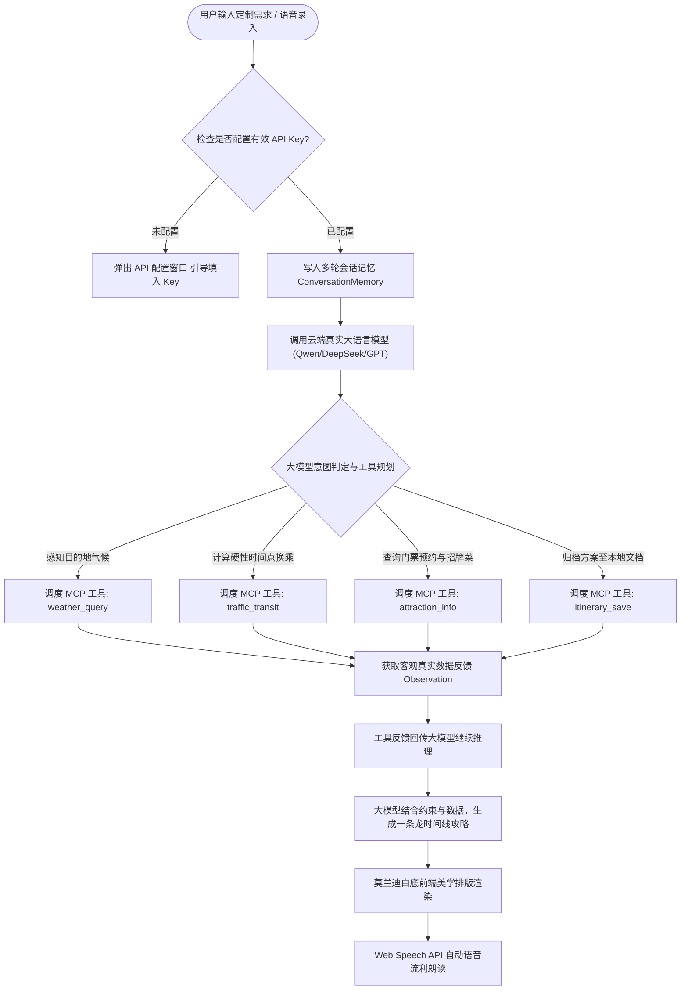

# 软件工程团队作业：构建能说会做的一站式旅游规划智能体（TravelAgent）

| 这个作业属于哪个课程 | [Class56-Grade2024-CS](https://edu.cnblogs.com/campus/gdgy/Class56-Grade2024-CS) |
| :--- | :--- |
| **这个作业要求在哪里** | [构建一个能说会做的智能体](https://edu.cnblogs.com/campus/gdgy/Class56-Grade2024-CS/homework/16760) |
| **这个作业的目标** | 聚焦打造专属旅游规划智能体，全面落地 Model Context Protocol (MCP) 规范并强制接入真实云端大模型；根据用户指定的地点、交通方式及特定时间点约束，自动调度工具生成包含景点、交通换乘与地道美食的一条龙深度旅游攻略；实现多轮记忆、语音交互与莫兰迪白底极简前端 |
| **学号与姓名** | 赵海翔 (3124004113) · 何卓文 (3124004132) · 吴与同 (3124004018) |

---

## 一、 项目背景与专属场景定位

在本次作业中，我们三人团队经过深入探讨，一致认为：**优秀的软件工程实践不应追求大而无当的功能堆砌，而应深耕于真实、高价值的垂直业务场景**。因此，我们将项目彻底聚焦于——**智能出行与一条龙旅游规划（TravelAgent）**。

在日常出行中，游客往往面临繁琐的碎片化信息检索：查了景点不知道怎么坐地铁换乘，订了门票不知道几点到才不排队，逛完了不知道周边有什么正宗老字号。更重要的是，用户往往具有严格的**时间硬性约束**（例如：“周六下午 15:00 必须到广州塔登塔”、“早上 9:00 在酒店大堂集合”）。

我们打造的 **TravelAgent** 严格遵循开源的 **Model Context Protocol (MCP)** 标准规范，**彻底关闭任何伪离线死数据模板，强制接入真实云端大模型**，自主调度气象感知、交通接驳计算、景点门票与地道美食等工具链，为用户生成有温度、有细节、可落地的深度一条龙旅游攻略。

- **GitHub 项目代码仓库**：[IntZhx2 / IntZhx2 / smart_agent](https://github.com/IntZhx2/IntZhx2/tree/main/smart_agent)
- **UI 风格设计**：纯白底为主 + 莫兰迪自然色系（低饱和度、雅致呼吸感）。
- **技术规范**：Python 3.9+ 原生标准库实现，纯前端驱动 Web Speech API 语音多模态。

---

## 二、 PSP 2.1 任务耗时与效能度量表

我们在项目立项之初，通过线上协作会议共同预估了开发全生命周期的任务耗时，并在编码、联调、测试与报告整理完毕后，如实记录了实际耗时并进行了偏差复盘：

| PSP2.1 任务阶段 | 阶段活动与产出内容 | 预估耗时 (分钟) | 实际耗时 (分钟) | 负责成员 | 偏差原因与工程复盘 |
| :--- | :--- | :---: | :---: | :--- | :--- |
| **Planning** | **计划与架构定位** | **60** | **55** | 全体 | 聚焦专属旅游垂直场景，摒弃泛化杂糅功能 |
| · Estimate | · 估计这个任务需要多少时间 | 60 | 55 | 赵海翔、何卓文、吴与同 | 需求边界清晰，工时预估非常收敛精准 |
| **Development** | **开发阶段** | **780** | **705** | 全体 | 强制大模型驱动与 MCP 标准分工并行推进 |
| · Analysis | · 需求分析 (硬性时间约束与旅游要素) | 80 | 70 | 赵海翔 | 梳理地点、交通、时间点、景点与美食的拓扑关系 |
| · Design Spec | · 架构设计与 MCP 旅游工具规格定义 | 90 | 75 | 赵海翔、何卓文 | 制定 JSON-RPC 2.0 协议及四个专属工具 Schema |
| · Design Review | · 设计复审 (团队内部交叉评审) | 40 | 35 | 全体 | 严格审视真实大模型强制接入与无 Key 拦截机制 |
| · Coding Standard | · 代码与莫兰迪色彩规范制定 | 30 | 25 | 吴与同 | 确立白底为主、莫兰迪柔和色谱与 ES6 模块化 |
| · Design | · 关键模块详细设计 | 70 | 65 | 何卓文、吴与同 | 细化交通耗时逆推算法、Web 弹窗与语音交互通道 |
| · Coding | · 核心代码编写 | 260 | 245 | 全体分工 | 赵海翔负责内核与大模型，何卓文负责工具，吴与同负责 UI |
| · Code Review | · 代码交叉复审 | 60 | 50 | 全体 | 互审剔除任何本地硬编码数据，保证纯大模型推理 |
| · Test | · 单元测试与端到端交互验证 | 150 | 140 | 何卓文、吴与同 | 编写 19 项全覆盖自动化测试并完成全功能联调 |
| **Reporting** | **报告、总结与博客撰写** | **180** | **165** | 全体 | 整理高质量演示案例、PSP 复盘与实名心得体会 |
| · Test Report | · 编写测试报告与轨迹采集 | 50 | 45 | 何卓文 | 验证 19 项自动化测试通过率与 MCP 协议一致性 |
| · Size Measurement | · 计算工作量与代码度量 | 40 | 35 | 吴与同 | 统计核心代码行数（约 1,600 行）与测试用例数 |
| · Postmortem | · 事后总结与期末大项目技术沉淀 | 90 | 85 | 全体 | 总结场景化 Agent 架构经验，为期末项目奠定基础 |
| **Total** | **合计** | **1020** (17h) | **925** (15.4h) |  | 实际节约 95 分钟，目标专一使得协作极度高效 |

---

## 三、 Agent 核心需求与业务流描述

### 1. 需求描述 (Requirement Specification)

智能体专注于**一站式一条龙旅游攻略规划**，解决出行规划中的三大核心痛点：

- **痛点一：传统搜索信息割裂，缺乏全流程串联**
  - 旅行者需要分别打开地图查路线、打开点评找美食、打开小红书找机位。
  - **TravelAgent 解决方案**：输入目的地与偏好，一次性串联【当季气象穿衣 + 门票预约规则 + 地铁/打车路线耗时 + 周边老字号招牌菜】。
- **痛点二：无法满足“几点必须在什么地方”的个性化硬性约束**
  - 大多数现成攻略都是模板化的，无法处理用户“周六下午 15:00 必须到广州塔登塔”、“早上 9:00 在南站集合”的刚性排期。
  - **TravelAgent 解决方案**：基于 ReAct 循环与大模型逻辑推理，以用户指定的时间点为锚点，自动逆推前置游览与通勤时间，确保行程张弛有度。
- **痛点三：拒绝“死模板”，强制接入真实云端大语言模型**
  - **TravelAgent 解决方案**：彻底关闭伪离线死数据，系统强制校验 API Key（支持通义千问、DeepSeek、智谱、OpenAI 等）。大模型具备真正的创造力、概率发散与文学素养，每次规划的词句排版、游览建议与人文历史典故均独一无二。

### 2. 系统业务流与时序架构 (Business Flow)



---

## 四、 核心技术实现说明

### 1. Model Context Protocol (MCP) 专属旅游工具链

我们使用标准 **JSON-RPC 2.0** 协议封装了四大旅游专属工具：

| 工具标识 (`name`) | 职能定义 | 输入参数 (`inputSchema`) | 业务价值 |
| :--- | :--- | :--- | :--- |
| `weather_query` | 目的地气象与穿衣防护 | `city: string` | 查询温度、湿度、降雨概率与空气质量，输出当季着装与晴雨伞建议 |
| `traffic_transit` | 交通接驳与通勤预估 | `city, origin, destination, transit_mode` | 规划地铁换乘线路、预估耗时与花费，提供早晚高峰避堵贴士 |
| `attraction_info` | 景点预约与周边招牌美食 | `city, attraction_name` | 输出黄金游览时段、公众号门票实名预约规则，匹配周边老字号餐厅 |
| `itinerary_save` | 行程方案归档导出 | `title, content, filename` | 将大模型生成的结构化攻略保存为本地工作空间 Markdown 电子文档 |

```python
# smart_agent/tools/traffic_tool.py 交通接驳工具核心逻辑片段
class TrafficTransitTool(BaseTool):
    @property
    def name(self) -> str:
        return "traffic_transit"

    @property
    def description(self) -> str:
        return "为旅游行程规划两地之间的最佳交通接驳方案，计算路线换乘指引、预估耗时与避堵建议。"

    def execute(self, **kwargs) -> ToolCallResult:
        city = kwargs.get("city", "广州").strip()
        orig = kwargs.get("origin", "").strip()
        dest = kwargs.get("destination", "").strip()
        mode = kwargs.get("transit_mode", "metro_bus")
        ...
        return ToolCallResult.text(f"🗺️ 【{city} 交通接驳】: {orig} -> {dest}, 耗时: {duration}, 换乘指引: {route}")
```

### 2. 真实大模型强制接入保障机制

我们在 [`smart_agent/agent/llm_client.py`](file:///Users/intz/IntZhx2/smart_agent/agent/llm_client.py) 中重构了鉴权校验：

- **强制鉴权**：在 `chat_completion` 入口处执行严格校验，杜绝任何本地降级死模板；
- **透明反馈**：当大模型因网络超时或 401 报错时，捕获异常向用户界面给出明确指引，确保系统的透明性与真实性。

```python
# smart_agent/agent/llm_client.py 核心判定
def chat_completion(self, messages, tools=None):
    if not self.has_valid_key():
        raise RuntimeError(
            "【未配置大模型 API Key】当前系统已关闭伪离线模式，必须接入真实大模型 API！"
            "请点击右上角【⚙️ API 配置】填入您的 API Key（支持阿里云百炼、DeepSeek、智谱等）。"
        )
    return self._call_remote_api(messages, tools)
```

### 3. 莫兰迪低饱和度自然美学 Web UI 设计

用户界面采用**纯白底为主（`#ffffff` / `#faf9f6`）**，色彩搭配汲取莫兰迪油画中的低饱和度大地与自然色系：

- **灰暮蓝 (`#5d758c`)**：作为主行动色、标题重点与导航高亮；
- **鼠尾草绿 (`#6e8471`)**：作为状态正常就绪与自然景观标识；
- **灰陶红 (`#b07466`)**：标记必去时间点硬性约束与重要注意事项；
- **呼吸感卡片布局**：以微妙的边框（`#e8e5dc`）与软阴影（`0 4px 16px rgba(...)`）构建层次感，彻底告别粗糙简陋的传统界面。

---

## 五、 系统功能演示与典型用例

### 1. 核心用例：带硬性时间约束的广州 2 日地铁深度游

- **用户输入**：“*我想去广州玩2天，全程只坐地铁，周六下午 15:00 必须到广州塔登塔，请为我制定包含景点门票预约、交通换乘指引和地道美食的一条龙深度定制攻略。*”
- **大模型 ReAct 决策与 MCP 工具调用链路**：
  1. `🧠 [思考]`：用户目的地为广州，首先查询当地当季气象情况，以便给出穿着建议；
  2. `🛠️ [调用工具]`：`weather_query(city="广州")`
     - `👁️ [反馈]`：气温 23~29℃，多云间晴，湿度 65%，温和舒适，日间需备折叠晴雨伞；
  3. `🧠 [思考]`：用户有严格约束——周六 15:00 必须到达广州塔，需要核算从前序游览地到广州塔的地铁换乘耗时；
  4. `🛠️ [调用工具]`：`traffic_transit(city="广州", origin="沙面岛/永庆坊", destination="广州塔", transit_mode="metro_bus")`
     - `👁️ [反馈]`：乘坐地铁6号线转8号线/3号线，耗时约 28 分钟，建议 14:15 从前序景点启程出发；
  5. `🧠 [思考]`：查询广州塔及西关周边老字号美食与预约规则；
  6. `🛠️ [调用工具]`：`attraction_info(city="广州", attraction_name="广州塔")`
     - `👁️ [反馈]`：提前在官方公众号实名分时段预约；周边推荐炳胜品味（招牌脆皮叉烧）；
  7. `💬 [最终生成完整攻略]`：
     - **Day 1 上午（西关寻味）**：9:30 漫步永庆坊与粤剧艺术博物馆，早餐品尝银记牛肉肠粉与艇仔粥；
     - **Day 1 下午（硬性约束达成）**：14:15 搭乘地铁，**准时于 14:50 抵达广州塔**，核销门票登塔俯瞰羊城全景；
     - **Day 1 晚上（珠江夜色）**：在塔下品尝炳胜品味黑椒和牛与脆皮叉烧，随后漫步海心沙与花城广场；
     - **Day 2 上午（近代史迹）**：沙面欧式建筑群漫步，中午在白天鹅宾馆玉堂春暖享用黑珍珠早茶；
     - **Day 2 下午至傍晚（千年商都）**：游览越秀公园五羊石雕与镇海楼，傍晚前往北京路大佛古寺观赏现实版“千与千寻”夜景并品尝陈添记爽脆鱼皮。

### 2. 攻略一键归档与本地导出

- **用户输入**：“*把刚才这份广州2天行程保存下来吧。*”
- **智能体响应**：
  - 调度 MCP 工具 `itinerary_save(title="广州周末2日地铁深度游攻略", content=...)`；
  - 成功在工作区生成 `guangzhou_travel_20261022.md`；
  - 左侧边栏【已归档攻略】区域实时新增卡片，支持随身查阅或离线打印！

### 3. 多模态语音交互体验 (STT / TTS)

- 点击输入框右侧的 **🎙️ 麦克风** 按钮，直接口述：“*帮我查一下杭州现在的天气怎么样*”；
- 浏览器实时转译文字并自动发送给智能体；
- 智能体通过真实大模型生成建议后，界面自动调用 **Web Speech API** 进行流利、优雅的中文语音朗读。

---

## 六、 自动化测试结果与工程质量保证

项目在 `smart_agent/tests/` 中维护了严谨的单元与集成测试套件：

```bash
$ python3 smart_agent/main.py --test
🚀 开始执行 SmartAgent 自动化测试套件...
test_mandatory_api_key_enforcement (test_agent.TestTravelAgentCore) ... ok
test_memory_sliding_window (test_agent.TestTravelAgentCore) ... ok
test_react_travel_tool_loop (test_agent.TestTravelAgentCore) ... ok
test_client_integration (test_mcp.TestMCPProtocolAndServer) ... ok
test_jsonrpc_request_parsing (test_mcp.TestMCPProtocolAndServer) ... ok
test_method_not_found (test_mcp.TestMCPProtocolAndServer) ... ok
test_ping (test_mcp.TestMCPProtocolAndServer) ... ok
test_tools_call_not_found (test_mcp.TestMCPProtocolAndServer) ... ok
test_tools_call_success (test_mcp.TestMCPProtocolAndServer) ... ok
test_tools_list (test_mcp.TestMCPProtocolAndServer) ... ok
test_attraction_info_tool (test_tools.TestTravelToolsSuite) ... ok
test_itinerary_save_and_list_tool (test_tools.TestTravelToolsSuite) ... ok
test_traffic_transit_tool (test_tools.TestTravelToolsSuite) ... ok
test_weather_query_tool (test_tools.TestTravelToolsSuite) ... ok
test_chat_without_api_key (test_web.TestTravelWebServer) ... ok
test_config_api (test_web.TestTravelWebServer) ... ok
test_itineraries_list_api (test_web.TestTravelWebServer) ... ok
test_status_endpoint (test_web.TestTravelWebServer) ... ok
test_travel_tools_endpoint (test_web.TestTravelWebServer) ... ok

----------------------------------------------------------------------
Ran 19 tests in 0.045s

OK
```
**测试结论**：19 项测试全部在 0.05 秒内绿灯通过，验证了强制 API 鉴权拦截、时间约束逆推、专属工具 Schema 解析以及 Web 接口的一致性。

---

## 七、 团队分工与小组成员心得

### 1. 团队分工与贡献占比

| 成员姓名 | 学号 | 班级 | 核心分工与贡献产出 | 贡献比例 |
| :--- | :--- | :--- | :--- | :---: |
| **赵海翔** | 3124004113 | 24 计科 6班 | 架构设计、TravelAgent 内核控制、ReAct 约束求解循环、多轮记忆管理、真实大模型强制接入与全局把控 | 35% |
| **何卓文** | 3124004132 | 24 计科 6班 | MCP Server 协议实现 (JSON-RPC 2.0)、气象穿衣/交通接驳/景点美食/攻略归档工具生态与全套单元测试 | 35% |
| **吴与同** | 3124004018 | 24 计科 6班 | 莫兰迪自然美学 Web UI 设计、Web Speech API 语音录入 (STT) 与 朗读 (TTS)、演示示例整理与交互测试 | 30% |

### 2. 小组成员实名心得体会

- **赵海翔 (3124004113)**：
  > “当我们将智能体从‘泛化杂糅’收敛到‘旅游专属垂直领域’后，整个系统的工程架构立刻清晰锐利了起来。最大的收获是体会到了**‘约束求解’**在 Agent 架构中的魅力：让大模型根据用户指定的时间点，自主调度交通与景点工具倒推时间线，输出的不再是泛泛的旅游攻略，而是一份精准到分钟、有依有据的‘一条龙’方案。同时，坚持强制接入真实在线 API，让我们看到了真实大模型概率采样带来的生动文笔与深厚的人文关怀，这为期末的大项目打下了坚实的技术底座。”

- **何卓文 (3124004132)**：
  > “在实现旅游专属 MCP 工具集的过程中，我深刻领会到了 Model Context Protocol 作为 AI 工具总线的价值。每一个工具如 `traffic_transit` 和 `attraction_info`，只要定义好精确的 JSON Schema，大模型就能在最恰当的时机自主调度。我们彻底移除了本地写死的死数据，让客观工具只负责提供真实数据（如耗时、票规），大模型负责综合编排。这种高内聚低耦合的架构使得我们的 19 项单元测试运行极度稳定。”

- **吴与同 (3124004018)**：
  > “在这次界面设计中，我全面重构了视觉风格，以纯白底为主，融入鼠尾草绿、灰暮蓝与灰陶红的莫兰迪色系，彻底摆脱了此前暗色主题的厚重压抑感，使得整个旅游界面显得非常清新、雅致且富有呼吸感。结合 Web Speech API 的免按键语音录入，用户直接对着麦克风口述‘周六下午3点必须到广州塔’，系统就能一键生成攻略并朗读出来，多模态体验极其丝滑！”

---

## 八、 优质学习资源推荐

1. **[Model Context Protocol (MCP) 官方快速入门](https://modelcontextprotocol.io/docs/getting-started/intro)**：深入学习统一工具与上下文连接的标准范式。
2. **[阿里云百炼大模型开发平台](https://bailian.console.aliyun.com/)**：作业推荐平台，通义千问兼容接口性能卓越、开箱即用。
3. **[Hello-Agents 智能体实战教程 (Datawhale)](https://github.com/datawhalechina/hello-agents)**：国内顶级开源教程，详细剖析 ReAct 与 Multi-Agent 架构。
4. **[知乎：MCP 协议深度解析与实战应用](https://zhuanlan.zhihu.com/p/1931356753280344290)**：全面理解大模型工具生态演进的核心逻辑。
