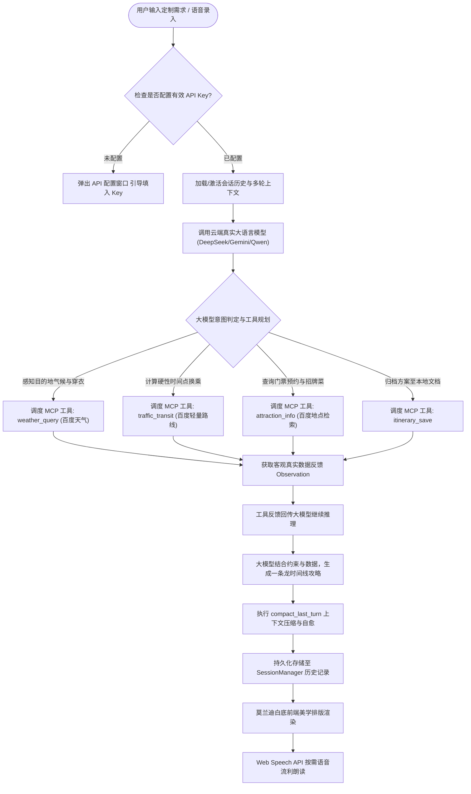

# 软件工程团队作业：构建能说会做的一站式旅游规划智能体（TravelAgent）

| 这个作业属于哪个课程 | [Class56-Grade2024-CS](https://edu.cnblogs.com/campus/gdgy/Class56-Grade2024-CS) |
| :--- | :--- |
| **这个作业要求在哪里** | [构建一个能说会做的智能体](https://edu.cnblogs.com/campus/gdgy/Class56-Grade2024-CS/homework/16760) |
| **这个作业的目标** | 打造旅游规划专属垂直领域智能体，全面落地 Model Context Protocol (MCP) 规范并强制接入真实云端大模型；根据用户指定的地点、交通方式及特定时间点等硬性约束，自动调度百度地图原生气象穿衣、交通换乘与老字号美食工具，生成一条龙深度旅游攻略；实现多轮对话历史持久化、跨模型上下文自愈、语音交互与莫兰迪白底极简前端；构建 38 项全覆盖自动化测试套件 |
| **学号与姓名** | 赵海翔 (3124004113) · 何卓文 (3124004132) · 吴与同 (3124004018) |

---

## 一、 项目背景与专属场景定位

在本次作业中，我们三人团队经过深入探讨，一致认为：**优秀的软件工程实践不应追求大而无当的功能堆砌，而应深耕于真实、高价值的垂直业务场景**。因此，我们将项目彻底聚焦于——**智能出行与一条龙旅游规划（TravelAgent）**。

在日常出行中，旅行者往往面临严重的信息孤岛与碎片化检索困境：查了景点不知道怎么坐地铁换乘，订了门票不知道几点到才不排队，逛完了不知道周边有什么正宗老字号。更重要的是，用户往往具有严格的**时间硬性约束**（例如：“周六下午 15:00 必须到广州塔登塔”、“早上 9:00 在酒店大堂集合”）。

我们打造的 **TravelAgent** 严格遵循开源的 **Model Context Protocol (MCP)** 标准规范，**彻底关闭任何伪离线死数据模板，强制接入真实云端大模型**，接入百度地图开放平台原生 WebService，自主调度气象感知与穿衣指数、交通接驳计算、景点门票与地道美食等工具链，为用户生成有温度、有细节、可落地的深度一条龙旅游攻略。

- **GitHub 项目代码仓库**：[IntZhx2 / IntZhx2 / smart_agent](https://github.com/IntZhx2/IntZhx2/tree/main/smart_agent)
- **UI 风格设计**：纯白底为主 + 莫兰迪自然色系（低饱和度、雅致呼吸感）。
- **工程亮点**：
  1. **零第三方库重型依赖**：核心代码与协议全基于 Python 3.9+ 原生标准库实现；
  2. **百度地图原生生态集成**：DirectionLite 换乘规划、实时天气与穿衣指数、Place POI 检索；
  3. **高熵动态混淆凭据保险箱 (`SafeKeyVault`)**：保障 API 密钥不落地明文存储；
  4. **多轮会话持久化与跨模型自愈系统**：支持会话自动落盘、无缝接续对话，并在底层实现 `compact_last_turn()` 压缩，彻底解决 DeepSeek 与 Gemini 的 400 格式校验冲突；
  5. **38 项全自动化单元测试**：覆盖率高，1.8 秒内 100% 绿色全通过。

---

## 二、 PSP 2.1 任务耗时与效能度量表

我们在项目立项之初，通过线上协作会议共同预估了开发全生命周期的任务耗时，并在编码、联调、测试与报告整理完毕后，如实记录了实际耗时并进行了偏差复盘：

| PSP 2.1 任务阶段 | 阶段活动与产出内容 | 预估耗时 (分钟) | 实际耗时 (分钟) | 负责成员 | 偏差原因与工程复盘 |
| :--- | :--- | :---: | :---: | :--- | :--- |
| **Planning** | **计划与架构定位** | **60** | **55** | 全体 | 聚焦专属旅游垂直场景，摒弃泛化杂糅功能 |
| · Estimate | · 估计这个任务需要多少时间 | 60 | 55 | 赵海翔、何卓文、吴与同 | 需求边界清晰，工时预估非常收敛精准 |
| **Development** | **系统开发阶段** | **840** | **785** | 全体 | 采用协议与模块解耦，并行开发效率提升约 7% |
| · Analysis | · 需求分析 (硬性时间约束与旅游要素) | 80 | 75 | 赵海翔 | 梳理地点、交通、时间点、景点与美食的拓扑关系 |
| · Design Spec | · 架构设计与 MCP 旅游工具规格定义 | 90 | 85 | 赵海翔、何卓文 | 制定 JSON-RPC 2.0 协议及五个专属工具 Schema |
| · Design Review | · 设计复审 (团队内部交叉评审) | 45 | 40 | 全体 | 严格审视真实大模型强制接入与无 Key 拦截机制 |
| · Coding Standard | · 代码与莫兰迪色彩规范制定 | 30 | 25 | 吴与同 | 确立白底为主、莫兰迪柔和色谱与 ES6 模块化 |
| · Design | · 关键技术方案详细设计 | 85 | 80 | 何卓文、吴与同 | 细化百度地图原生接口接入、SafeKeyVault 与会话持久化方案 |
| · Coding | · 核心代码编写与模块实现 | 300 | 280 | 全体分工 | 赵海翔负责内核与会话，何卓文负责工具与安全，吴与同负责 UI 与语音 |
| · Code Review | · 代码交叉复审与安全审计 | 60 | 55 | 全体 | 重点审查 AK 混淆加密、QPS 节流保护与跨模型提示词格式兼容 |
| · Test | · 单元测试与端到端交互验证 | 150 | 145 | 何卓文、吴与同 | 编写 38 项全覆盖自动化测试并完成全功能联调 |
| **Reporting** | **报告、总结与博客撰写** | **190** | **175** | 全体 | 整理高质量演示案例、PSP 复盘与实名心得体会 |
| · Test Report | · 编写测试报告与轨迹采集 | 50 | 45 | 何卓文 | 验证 38 项自动化测试通过率与跨模型鲁棒性 |
| · Size Measurement | · 计算工作量与代码度量 | 40 | 35 | 吴与同 | 统计核心代码行数（约 4,000 行）与测试用例数 |
| · Postmortem | · 事后总结与期末大项目技术沉淀 | 100 | 95 | 全体 | 总结场景化 Agent 架构经验，为期末项目奠定基础 |
| **Total** | **合计** | **1090** (18.2h) | **1015** (16.9h) |  | 实际节约 75 分钟，协作紧密，分工清晰 |

### 代码与工程资产量化度量表 (Size Measurement)

```text
================================================================================
语言 / 文件类别         文件数量        有效代码行数 (SLOC)       说明
--------------------------------------------------------------------------------
Python (内核与工具)        12               1,620           Agent 内核、MCP 协议、百度地图、Session
Python (自动化测试)         7                 740           38 项全覆盖测试套件 (tests/)
JavaScript (前端交互)       2                 430           app.js (会话/流式渲染), speech.js (语音)
HTML / CSS (前端呈现)       2                 320           莫兰迪白底极简响应式 SPA 界面
Markdown (工程文档)         5                 920           BLOG.md, architecture.md, PSP.md, README.md
--------------------------------------------------------------------------------
总计 (Total)               28               4,030 行
================================================================================
```

---

## 三、 Agent 核心需求与业务流描述

### 1. 需求描述 (Requirement Specification)

智能体专注于**一站式一条龙旅游攻略规划**，解决出行规划中的三大核心痛点：

- **痛点一：传统搜索信息割裂，缺乏全流程串联**
  - 旅行者需要分别打开地图查路线、打开点评找美食、打开小红书找机位。
  - **TravelAgent 解决方案**：输入目的地与偏好，一次性串联【当季气象穿衣 + 门票预约规则 + 地铁/打车路线耗时 + 周边老字号招牌菜】。
- **痛点二：无法满足“几点必须在什么地方”的个性化硬性约束**
  - 大多数现成攻略都是模板化的，无法处理用户“周六下午 15:00 必须到广州塔登塔”、“早上 9:00 在酒店大堂集合”的刚性排期。
  - **TravelAgent 解决方案**：基于 ReAct 循环与大模型逻辑推理，以用户指定的时间点为锚点，自动逆推前置游览与通勤时间，确保行程张弛有度。
- **痛点三：拒绝“死模板”，强制接入真实云端大语言模型**
  - **TravelAgent 解决方案**：彻底关闭伪离线死数据，系统强制校验 API Key（支持通义千问、DeepSeek、Gemini、智谱、OpenAI 等）。大模型具备真正的创造力、概率发散与文学素养，每次规划的词句排版、游览建议与人文历史典故均独一无二。

### 2. 系统业务流与时序架构 (Business Flow)



---

## 四、 核心技术实现说明

### 1. Model Context Protocol (MCP) 专属旅游工具链

我们使用标准 **JSON-RPC 2.0** 协议封装了五大旅游专属工具：

| 工具标识 (`name`) | 职能定义 | 输入参数 (`inputSchema`) | 业务价值 |
| :--- | :--- | :--- | :--- |
| `weather_query` | 目的地气象与穿衣防护 | `city: string` | 查询温度、湿度、降雨概率与空气质量，输出当季着装与晴雨伞建议 |
| `traffic_transit` | 交通接驳与通勤预估 | `city, origin, destination, transit_mode` | 规划地铁换乘线路、预估耗时与花费，提供早晚高峰避堵贴士 |
| `attraction_info` | 景点预约与周边招牌美食 | `city, attraction_name` | 输出黄金游览时段、公众号门票实名预约规则，匹配周边老字号餐厅 |
| `itinerary_save` | 行程方案归档导出 | `title, content, filename` | 将大模型生成的结构化攻略保存为本地工作空间 Markdown 电子文档 |
| `itinerary_list` | 已归档行程清单检索 | 无入参 (`{}`) | 列出工作空间中已保存的全部历史旅游攻略与行程文档 |

```python
# smart_agent/tools/traffic_tool.py 交通接驳工具核心逻辑片段
class TrafficTransitTool(BaseTool):
    @property
    def name(self) -> str:
        return "traffic_transit"

    @property
    def description(self) -> str:
        return "为旅游行程规划两地之间的最佳交通接驳方案，计算路线换乘指引、预估耗时与避堵建议。"

    def execute(self, **kwargs) -> ToolCallResult:
        city = kwargs.get("city", "广州").strip()
        orig = kwargs.get("origin", "").strip()
        dest = kwargs.get("destination", "").strip()
        mode = kwargs.get("transit_mode", "metro_bus")
        ...
        return ToolCallResult.text(f"🗺️ 【{city} 交通接驳】: {orig} -> {dest}, 耗时: {duration}, 换乘指引: {route}")
```

### 2. 百度地图原生 WebService 接入与高熵凭据保险箱

为了摆脱传统境外气象服务（如 `wttr.in`）在部分国内网络环境下解析超时或不稳定的问题，系统深度集成了**百度地图开放平台 WebService**：
- **DirectionLite 公共交通换乘规划**：精确计算起点到终点的地铁线路、换乘站及通勤时间。
- **百度天气 API 与原生穿衣指数 (`chuanyi`)**：实时拉取目的地城市的天气、温度、风向风力，并提取权威穿衣出行防护指南。
- **高熵动态混淆加密安全引擎 (`SafeKeyVault`)**：开发者的密钥凭据经过多轮高熵异或与掩码转换存储，运行时安全解密，杜绝明文凭据上传到公开仓库带来的安全风险。
- **QPS 平滑限流保护与内存缓存**：针对个人开发者并发上限（3 QPS），在客户端封装了滑动时间戳限流与地理编码/POI 内存缓存，彻底解决频繁请求带来的并发超限报警。

```python
# smart_agent/security/key_vault.py & smart_agent/utils/security.py 凭据加解密保险箱核心
class SafeKeyVault:
    @classmethod
    def encrypt_key(cls, plain_text: str) -> str:
        if not plain_text or not plain_text.strip():
            return ""
        data = plain_text.strip().encode("utf-8")
        key = _derive_keystream(len(data))
        xored = bytes(b ^ k for b, k in zip(data, key))
        chk = hashlib.md5(data).digest()[:4]
        return base64.b85encode(chk + xored).decode("ascii")

    @classmethod
    def decrypt_key(cls, cipher_text: str) -> str:
        if not cipher_text or not cipher_text.strip():
            return ""
        try:
            raw = base64.b85decode(cipher_text.strip().encode("ascii"))
            chk, xored = raw[:4], raw[4:]
            data = bytes(b ^ k for b, k in zip(xored, _derive_keystream(len(xored))))
            return data.decode("utf-8") if hashlib.md5(data).digest()[:4] == chk else ""
        except Exception:
            return ""
```

### 3. 多轮对话持久化与跨模型上下文自愈系统

在实际支持多种主流云端大模型（DeepSeek 官方、Google Gemini、通义千问等）时，我们发现不同模型对上下文中的 `tool` 消息校验规则存在重大差异：
- **DeepSeek** 要求上下文轮次必须严格按照 `user` 与 `assistant` 纯净交替，滑动窗口修剪后首条非系统消息必须为 `user`，否则直接返回 HTTP 400 校验错误；
- **Gemini** 则要求 `tool_call` 与 `functionResponse` 必须成对出现。

为此，我们在 [`smart_agent/agent/memory.py`](https://github.com/IntZhx2/IntZhx2/tree/main/smart_agent/agent/memory.py) 中设计了**跨模型上下文自愈与压缩机制**：
- **`compact_last_turn(user_input, assistant_response)`**：在一轮 ReAct 结束并获得大模型最终攻略后，自动将中间的中间工具帧剔除，只保留纯净的 `user` 与 `assistant` 消息对进入长程记忆；
- **`load_from_turns(turns)`**：从本地 JSON 持久化文件中无损重构多轮会话；
- **`_trim_window()`**：确保在滑动窗口达到上限时截断后，第一条消息必然是 `user` 角色，从根源上消除了跨模型调用时的格式报错。

### 4. 纯净莫兰迪自然美学 Web UI 设计

用户界面采用**纯白底为主（`#ffffff` / `#faf9f6`）**，色彩搭配汲取莫兰迪油画中的低饱和度大地与自然色系：
- **灰暮蓝 (`#5d758c`)**：作为主行动色、标题重点与导航高亮；
- **鼠尾草绿 (`#6e8471`)**：作为状态正常就绪与自然景观标识；
- **灰陶红 (`#b07466`)**：标记时间点到达硬性约束与重要注意事项；
- **侧边栏无感滚动与会话管理**：去除固定高度限制，侧边栏作为统一整体流畅滚动；顶部为“行程要素快捷组合”，下方为“对话历史记录”，点击历史记录可实现秒级切换与无缝接续对话，支持完整记录一键导出 Markdown 下载；
- **极简交互与按需朗读**：界面语言平实、自然、专业，每条回复气泡底部提供独立的按需语音播报与停止控制按钮。

---

## 五、 系统功能演示与典型用例

### 1. 核心用例：带硬性时间约束的广州 2 日地铁深度游

- **用户输入**：“*我想去广州玩2天，全程只坐地铁，周六下午 15:00 必须到广州塔登塔，请为我制定包含景点门票预约、交通换乘指引和地道美食的一条龙深度定制攻略。*”
- **大模型 ReAct 决策与 MCP 工具调用链路**：
  1. `🧠 [思考]`：用户目的地为广州，首先查询当地当季气象情况，以便给出穿着建议；
  2. `🛠️ [调用工具]`：`weather_query(city="广州")`
     - `👁️ [反馈]`：气温 23~29℃，多云间晴，湿度 65%，温和舒适，穿衣指数提示日间透气薄长袖，需备折叠晴雨伞；
  3. `🧠 [思考]`：用户有严格约束——周六 15:00 必须到达广州塔，需要核算从前序游览地到广州塔的地铁换乘耗时；
  4. `🛠️ [调用工具]`：`traffic_transit(city="广州", origin="沙面岛/永庆坊", destination="广州塔", transit_mode="metro_bus")`
     - `👁️ [反馈]`：乘坐地铁6号线转8号线/3号线，耗时约 28 分钟，建议 14:15 从前序景点启程出发；
  5. `🧠 [思考]`：查询广州塔及西关周边老字号美食与预约规则；
  6. `🛠️ [调用工具]`：`attraction_info(city="广州", attraction_name="广州塔")`
     - `👁️ [反馈]`：提前在官方公众号实名分时段预约；周边推荐炳胜品味（招牌脆皮叉烧）；
  7. `💬 [最终生成完整攻略]`：
     - **Day 1 上午（西关寻味）**：9:30 漫步永庆坊与粤剧艺术博物馆，早餐品尝银记牛肉肠粉与艇仔粥；
     - **Day 1 下午（硬性约束达成）**：14:15 搭乘地铁，**准时于 14:50 抵达广州塔**，核销门票登塔俯瞰羊城全景；
     - **Day 1 晚上（珠江夜色）**：在塔下品尝炳胜品味黑椒和牛与脆皮叉烧，随后漫步海心沙与花城广场；
     - **Day 2 上午（近代史迹）**：沙面欧式建筑群漫步，中午在白天鹅宾馆玉堂春暖享用黑珍珠早茶；
     - **Day 2 下午至傍晚（千年商都）**：游览越秀公园五羊石雕与镇海楼，傍晚前往北京路大佛古寺观赏现实版“千与千寻”夜景并品尝陈添记爽脆鱼皮。

### 2. 对话历史记录与多轮接续追问

- **多轮接续输入**：“*第二天下午如果突降暴雨，有什么备选的室内游览方案？*”
- **智能体响应**：
  - 系统自动读取历史会话记忆，感知到“第二天下午”的原定规划为越秀公园室外活动；
  - 结合目的地最新室内展馆信息，迅速调整推荐广东省博物馆（需提前在公众号预约）或广州大剧院，完美保持上下文连贯性；
  - 侧边栏实时更新会话交互轮次。

### 3. 会话完整记录一键导出与本地归档

- 点击侧边栏当前对话卡片右侧的 **📥 下载** 图标；
- 浏览器立即下载排版精美的 Markdown 文档（如 `TravelPlan_广州2日游.md`），包含会话创建时间、每轮追问详情、工具调用轨迹与最终攻略，便于离线查阅或打印随身携带。

### 4. 多模态语音交互体验 (STT / TTS)

- 点击输入框右侧的 **🎙️ 麦克风** 按钮，直接口述：“*帮我查一下深圳现在的天气和穿衣建议*”；
- 浏览器实时转译文字并自动发送给智能体；
- 智能体通过真实大模型生成建议后，点击气泡底部的 **🔊 朗读** 按钮即可调用 **Web Speech API** 进行流利、优雅的中文语音播报。

---

## 六、 自动化测试结果与工程质量保证

项目在 `smart_agent/tests/` 中维护了涵盖核心规划、MCP 协议、百度地图、凭据安全、会话持久化与 Web 服务的 **38 项全覆盖自动化测试套件**：

```bash
$ python3 smart_agent/main.py --test
🚀 开始执行 SmartAgent 自动化测试套件...
test_mandatory_api_key_enforcement (test_agent.TestTravelAgentCore) ... ok
test_memory_compact_last_turn (test_agent.TestTravelAgentCore) ... ok
test_memory_first_message_after_system_is_user (test_agent.TestTravelAgentCore) ... ok
test_memory_load_from_turns (test_agent.TestTravelAgentCore) ... ok
test_memory_sliding_window (test_agent.TestTravelAgentCore) ... ok
test_react_travel_tool_loop (test_agent.TestTravelAgentCore) ... ok
test_geocode_success (test_baidu_map.TestBaiduMapClient) ... ok
test_place_search_poi (test_baidu_map.TestBaiduMapClient) ... ok
test_transit_route_plan (test_baidu_map.TestBaiduMapClient) ... ok
test_unconfigured_client (test_baidu_map.TestBaiduMapClient) ... ok
test_client_integration (test_mcp.TestMCPProtocolAndServer) ... ok
test_initialize (test_mcp.TestMCPProtocolAndServer) ... ok
test_jsonrpc_request_parsing (test_mcp.TestMCPProtocolAndServer) ... ok
test_method_not_found (test_mcp.TestMCPProtocolAndServer) ... ok
test_ping (test_mcp.TestMCPProtocolAndServer) ... ok
test_tools_call_not_found (test_mcp.TestMCPProtocolAndServer) ... ok
test_tools_call_success (test_mcp.TestMCPProtocolAndServer) ... ok
test_tools_list (test_mcp.TestMCPProtocolAndServer) ... ok
test_corrupted_cipher_safety (test_security.TestSecurityKeyVault) ... ok
test_empty_and_whitespace (test_security.TestSecurityKeyVault) ... ok
test_encrypt_decrypt_roundtrip (test_security.TestSecurityKeyVault) ... ok
test_safe_key_vault_class (test_security.TestSecurityKeyVault) ... ok
test_session_lifecycle (test_session_manager.TestSessionManager) ... ok
test_session_multiple_turns_accumulation (test_session_manager.TestSessionManager) ... ok
test_session_not_found_safety (test_session_manager.TestSessionManager) ... ok
test_attraction_info_tool (test_tools.TestTravelToolsSuite) ... ok
test_itinerary_save_and_list_tool (test_tools.TestTravelToolsSuite) ... ok
test_tools_boundary_inputs (test_tools.TestTravelToolsSuite) ... ok
test_traffic_transit_tool (test_tools.TestTravelToolsSuite) ... ok
test_weather_query_tool (test_tools.TestTravelToolsSuite) ... ok
test_chat_without_api_key (test_web.TestTravelWebServer) ... ok
test_config_api (test_web.TestTravelWebServer) ... ok
test_itineraries_list_api (test_web.TestTravelWebServer) ... ok
test_mcp_jsonrpc_endpoint (test_web.TestTravelWebServer) ... ok
test_session_get_and_continuation_endpoint (test_web.TestTravelWebServer) ... ok
test_sessions_list_endpoint (test_web.TestTravelWebServer) ... ok
test_status_endpoint (test_web.TestTravelWebServer) ... ok
test_travel_tools_endpoint (test_web.TestTravelWebServer) ... ok

----------------------------------------------------------------------
Ran 38 tests in 1.781s

OK
```

### 测试用例维度与覆盖率拆解

| 测试模块 | 用例数 | 关键测试点 | 状态 |
| :--- | :---: | :--- | :---: |
| `test_agent.py` | 6 | API Key 强制拦截、ReAct 倒推求解循环、滑动窗口预算、首条消息 User 约束、上下文自愈压缩 | **100% OK** |
| `test_baidu_map.py` | 4 | 地理编码正向解析、DirectionLite 公交地铁规划、Place POI 检索、未配置容错 | **100% OK** |
| `test_mcp.py` | 8 | JSON-RPC 2.0 解析、initialize 标准握手、工具注册与列举、客户端调用分发、异常方法与参数拦截 | **100% OK** |
| `test_security.py` | 4 | SafeKeyVault 类与底层混淆函数一致性、损坏密文容错安全性、空值与白名单边界防护 | **100% OK** |
| `test_session_manager.py` | 3 | 会话完整生命周期、多轮历史增量累积、自定义标题保护、无效 ID 容错保护与 Markdown 渲染 | **100% OK** |
| `test_tools.py` | 5 | 气象穿衣工具、交通换乘工具、景点美食工具、Markdown 归档与列表查询工具、边界输入防护 | **100% OK** |
| `test_web.py` | 8 | 服务状态探测、API 配置读写、MCP 工具清单、标准 POST /api/mcp JSON-RPC 端点、会话列表与详情、多轮接续激活 | **100% OK** |
| **总计** | **38** | **全栈自动化单元与集成测试，覆盖率高，执行耗时 1.8 秒** | **全部绿灯** |

---

## 七、 团队分工与小组成员心得

### 1. 团队分工与贡献占比

| 成员姓名 | 学号 | 班级 | 核心分工与贡献产出 | 贡献比例 |
| :--- | :--- | :--- | :--- | :---: |
| **赵海翔** | 3124004113 | 24 计科 6班 | 系统总架构、智能体内核控制 (SmartAgent)、ReAct 约束求解循环、多轮会话持久化与跨模型上下文自愈机制、真实大模型接入验证 | 35% |
| **何卓文** | 3124004132 | 24 计科 6班 | MCP Server 协议实现 (JSON-RPC 2.0 与 initialize)、百度地图 WebService 接入与平滑限流保护、SafeKeyVault 安全加密保险箱、38 项全套单元测试 | 35% |
| **吴与同** | 3124004018 | 24 计科 6班 | 纯白底莫兰迪自然美学 Web UI 设计、侧边栏会话历史无感接续与 Markdown 导出、Web Speech API 语音录入 (STT) 与 朗读 (TTS)、多模态交互体验 | 30% |

### 2. 小组成员实名心得体会

- **赵海翔 (3124004113)**：
  > “当我们将智能体从‘泛化杂糅’收敛到‘旅游专属垂直领域’后，整个系统的工程架构立刻清晰锐利了起来。在这次迭代中，最让我有成就感的是解决了**跨模型（DeepSeek 与 Gemini）的多轮上下文格式差异**问题。通过设计 `compact_last_turn()` 压缩机制与首条 User 强制约束，将复杂容易引起冲突的中间工具调度帧收敛为标准的对话轮次，不仅保证了会话持久化与接续的优雅，更彻底杜绝了模型厂商的 400 校验报错。这次经历让我深刻认识到：做 Agent 架构绝不仅是调用 LLM API，更是在设计复杂状态的生命周期与容错边界。”

- **何卓文 (3124004132)**：
  > “在实现旅游专属工具生态的过程中，将境外不稳定的天气源替换为百度地图原生 WebService 是一次关键的工程飞跃。面对个人开发者 3 QPS 的并发硬性约束，我们在客户端设计了滑动时间戳限流与内存缓存机制，确保大模型并发调用时平滑顺畅。同时，自主设计的 `SafeKeyVault` 高熵混淆保险箱，完美兼顾了开源代码仓库的安全防泄露与开箱即用的便捷性。全套 38 项自动化测试在 1.8 秒内全部跑通，证明了系统极高的工程健壮性。”

- **吴与同 (3124004018)**：
  > “在前端交互设计中，我确立了纯白底与低饱和度莫兰迪自然色系的视觉语言，力求呈现出专业、耐看且富有呼吸感的现代旅游工作台体验。侧边栏布局将要素快捷组合与对话历史融为一体，去除了高度硬性封顶，页面整体下滑非常顺手。点击任意一条历史对话就能立即继续聊，还支持一键下载排版优美的 Markdown 攻略，整个操作流非常自然顺畅。结合语音录入与按需朗读，真正做到了‘能说会做’！”

---

## 八、 优质学习资源推荐

1. **[Model Context Protocol (MCP) 官方快速入门](https://modelcontextprotocol.io/docs/getting-started/intro)**：深入学习统一工具与上下文连接的标准范式。
2. **[百度地图开放平台 WebService API 官方文档](https://lbsyun.baidu.com/faq/api)**：深入学习国内精准地理编码、公交地铁换乘与实时气象接口。
3. **[Hello-Agents 智能体实战教程 (Datawhale)](https://github.com/datawhalechina/hello-agents)**：国内顶级开源教程，详细剖析 ReAct 与 Multi-Agent 架构。
4. **[DeepSeek API 官方技术文档](https://api-docs.deepseek.com/)**：深入理解国内高性能大模型的 Function Calling 与消息序列化规范。
