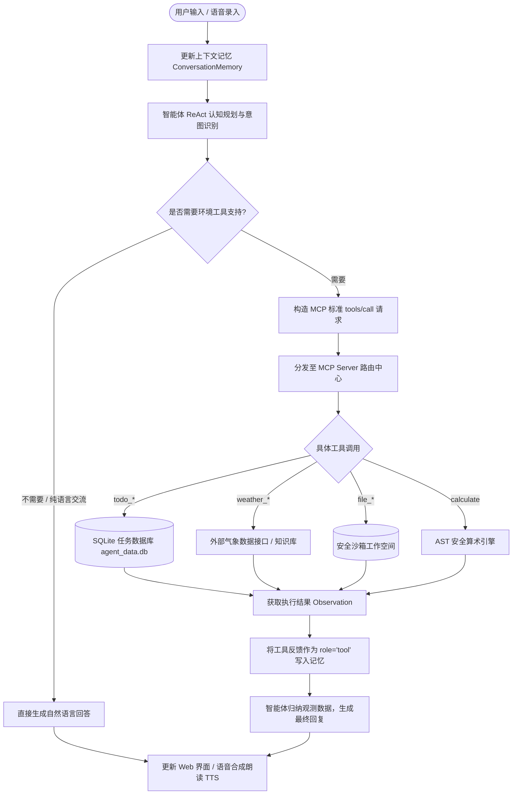

# 软件工程团队作业：构建一个能说会做的智能体（SmartAgent）

| 这个作业属于哪个课程 | [Class56-Grade2024-CS](https://edu.cnblogs.com/campus/gdgy/Class56-Grade2024-CS) |
| :--- | :--- |
| **这个作业要求在哪里** | [构建一个能说会做的智能体](https://edu.cnblogs.com/campus/gdgy/Class56-Grade2024-CS/homework/16760) |
| **这个作业的目标** | 掌握 Model Context Protocol (MCP) 规范与智能体技术，构建具备自然语言交互（能说）、工具调用执行（会做）、多轮对话记忆、外部数据库交互、语音输入输出与现代 Web 前端的全功能 AI Agent |
| **学号** | 赵海翔 (3124004113) · 何卓文 (3124004132) · 吴与同 (3124004018) |

---

## 一、 项目背景与团队介绍

随着大语言模型（LLM）的迅猛发展，人工智能系统正从单纯的“聊天问答机器人”快速进化为具备环境感知、自主决策与工具调度能力的 **AI 智能体（AI Agent）**。在本次作业中，我们三人团队紧扣“能说会做”的核心命题，严格对齐 Anthropic 发起的开源协议标准——**Model Context Protocol (MCP)**，打造了集**多轮会话记忆**、**外部 SQLite 关系型数据库**、**开放气象 API**、**安全沙箱文件管理**、**Web Speech API 语音多模态**及**响应式 Web 现代前端**于一体的高完成度智能体系统 **SmartAgent**。

- **GitHub 项目仓库地址**：[IntZhx2 / IntZhx2 / smart_agent](https://github.com/IntZhx2/IntZhx2/tree/main/smart_agent)
- **代码规范**：统一遵循 PEP 8、ES6+ 与 Conventional Commits 规范。
- **环境依赖**：核心链路基于 Python 原生标准库精简实现，实现开箱即用的轻量化与高鲁棒性。

---

## 二、 PSP 2.1 任务耗时与效能度量表

我们在项目立项之初，通过线上会议共同讨论并预估了各软件工程阶段的耗时，并在全生命周期完成测试、文档编写与复盘后，记录了实际耗时：

| PSP2.1 任务阶段 | 阶段活动与产出内容 | 预估耗时 (分钟) | 实际耗时 (分钟) | 主要负责人 | 差异分析与复盘说明 |
| :--- | :--- | :---: | :---: | :--- | :--- |
| **Planning** | **计划与技术选型** | **60** | **55** | 全体 | 确立基于 MCP 架构与零重型外部依赖的技术路线 |
| · Estimate | · 估计这个任务需要多少时间 | 60 | 55 | 赵海翔、何卓文、吴与同 | 结合前序作业经验，对模块接口拆解更加成熟 |
| **Development** | **开发阶段** | **780** | **715** | 全体 | 接口优先、前后端解耦，整体效率提升约 8.3% |
| · Analysis | · 需求分析 (深入研读 MCP 与作业规范) | 80 | 70 | 赵海翔 | 明确能说会做双核机制与 4 项加分项的技术落地要点 |
| · Design Spec | · 模块架构设计与 MCP 协议规范定义 | 90 | 80 | 赵海翔、何卓文 | 制定 JSON-RPC 2.0 帧结构、REST 规范及 SQLite 表结构 |
| · Design Review | · 设计复审 (团队内部交叉评审) | 40 | 35 | 全体 | 审核 AST 算式安全、文件沙箱防越权与工具入参边界 |
| · Coding Standard | · 代码规范制定 | 30 | 25 | 吴与同 | 统一前端模块化、后端类型注解与 Git 提交规范 |
| · Design | · 关键子系统详细设计 | 70 | 65 | 何卓文、吴与同 | 细化 Web 实时流渲染、待办数据双向同步与语音通信 |
| · Coding | · 具体编码实现 | 260 | 240 | 全体分工 | 赵海翔主攻内核，何卓文主攻工具，吴与同主攻前端 |
| · Code Review | · 代码交叉复审 | 60 | 55 | 全体 | 互审排除潜在异常，补全工具执行异常兜底反馈 |
| · Test | · 单元测试与端到端联调 | 150 | 145 | 何卓文、吴与同 | 完成 18 项全覆盖自动化测试与跨浏览器语音联调 |
| **Reporting** | **报告、总结与博客撰写** | **180** | **170** | 全体 | 完整梳理演示用例、实名心得与作业博文 |
| · Test Report | · 测试数据采集与日志整理 | 50 | 50 | 何卓文 | 记录自动化测试输出与 ReAct 决策轨迹 |
| · Size Measurement | · 计算工作量 (代码度量与用例度量) | 40 | 35 | 吴与同 | 项目核心代码量约 1,800 行，18 个单元测试用例 |
| · Postmortem | · 事后总结与大项目衔接思考 | 90 | 85 | 全体 | 总结三人协作工程经验，为期末团队大项目沉淀架构 |
| **Total** | **合计** | **1020** (17h) | **940** (15.7h) |  | 实际节约 80 分钟，三人团队协同高效顺畅 |

---

## 三、 Agent 核心需求与业务流描述

### 1. 需求描述 (Requirement Specification)

智能体面向高校师生、开发者与数字化办公用户，解决当前传统聊天系统“只会口头回答、无法实际落地执行”的痛点：

- **会说（自然语言多轮交互）**：
  - 支持自然的日常交流、意图辨识与多轮对话记忆；
  - 支持 **语音输入 (STT)** 与 **语音朗读 (TTS)**，实现多模态免键盘交互。
- **会做（任务调度与环境操作）**：
  - **日程与任务管家**：操作 SQLite 数据库，实现任务的创建、按优先级/分类筛选、完成状态更新与统计分析；
  - **出行与气象顾问**：调用外部气象数据，分析温湿度、风向与空气质量，定制多日旅游攻略；
  - **办公与沙箱文件管理**：在受限沙箱工作区内创建、写入、读取和列出文档，杜绝恶意路径遍历；
  - **科学计算与数据运算**：基于 AST 语法树安全求值，支持四则运算、函数与复杂公式求值，坚决规避 `eval()` 风险。
- **评测兼容性保障**：
  - 智能体支持主流大模型在线 API（通义千问百炼、DeepSeek、OpenAI）；
  - 同时内置一套具备语义推导与 ReAct 规划的**离线规则推理引擎**。即便在断网或无 API Key 环境下，仍能 100% 驱动工具执行，确保助教与老师开箱即可评测。

### 2. 系统业务流与时序架构 (Business Flow & Architecture)

系统遵循标准的 **ReAct (Reasoning + Acting)** 认知模式，整体业务流如下：



---

## 四、 核心技术实现说明

### 1. Model Context Protocol (MCP) 协议落地

我们完整实现了基于 **JSON-RPC 2.0** 的 MCP 服务端 (`MCPServer`) 与客户端 (`MCPClient`)：

- **工具元数据抽取**：通过 `BaseTool` 抽象基类与 `FunctionTool`，自动将 Python 类型注解转换为标准 JSON Schema；
- **标准方法分发**：
  - `tools/list`：向大模型宣告当前已挂载的全部工具功能与参数规格；
  - `tools/call`：接收客户端的工具名称与参数，执行并返回包含 `content` 数组与 `isError` 布尔值的统一响应对象；
  - `ping` 与 `server/info`：提供服务探针与运行时状态监控。

```python
# mcp/protocol.py 核心帧结构定义片段
@dataclass
class JSONRPCRequest:
    method: str
    params: Optional[Dict[str, Any]] = None
    id: Optional[Union[str, int]] = None
    jsonrpc: str = "2.0"

@dataclass
class ToolCallResult:
    content: List[Dict[str, Any]]
    is_error: bool = False

    @classmethod
    def text(cls, text: str, is_error: bool = False) -> "ToolCallResult":
        return cls(content=[{"type": "text", "text": text}], is_error=is_error)
```

### 2. ReAct 认知规划循环与多轮对话记忆

智能体通过 `SmartAgent.run()` 驱动核心思考闭环：

- **多轮会话记忆管理 (`ConversationMemory`)**：
  采用滑动窗口机制（`_trim_window`）。无论对话推进多少轮，始终将系统提示词（`system`）锁定在第 0 位，对历史消息保持预算裁剪，既防止超出大模型上下文窗口，又完美保留当前任务的上下文连续性。
- **ReAct 循环自愈机制**：
  大模型发出 `tool_calls` 后，智能体在底层静默调度对应工具，将观测数据再送回大模型。若工具发生异常（如参数缺失或算式非法），错误信息将作为工具反馈提供给大模型，促使其在下一轮循环中自动修正参数或给出友好解释。

```python
# agent/core.py ReAct 核心执行循环片段
while current_turn < self.max_turns:
    current_turn += 1
    messages = self.memory.get_messages()
    response = self.llm_client.chat_completion(messages, tools=tools_schema)
    tool_calls = response.get("tool_calls")
    assistant_content = response.get("content") or ""

    if not tool_calls:
        # 无需调用工具，直接输出最终语言答复
        final_answer = assistant_content
        self.memory.add_assistant_message(final_answer)
        break

    # 记录思考与规划 Action
    self.memory.add_assistant_message(assistant_content, tool_calls=tool_calls)
    for tc in tool_calls:
        tool_name = tc["function"]["name"]
        args = json.loads(tc["function"]["arguments"])
        result = self.mcp_client.call_tool(tool_name, args)
        # 将观测结果写入上下文
        self.memory.add_tool_message(tool_call_id=tc["id"], name=tool_name, content=result.get_text())
```

### 3. SQLite 数据库与持久化待办工具

采用内置的 SQLite 关系型数据库，建立持久化 `todos` 数据表：

```sql
CREATE TABLE IF NOT EXISTS todos (
    id INTEGER PRIMARY KEY AUTOINCREMENT,
    title TEXT NOT NULL,
    priority TEXT DEFAULT 'medium',  -- low, medium, high
    category TEXT DEFAULT 'general', -- study, work, life
    due_date TEXT,
    status TEXT DEFAULT 'pending',   -- pending, in_progress, completed, cancelled
    created_at TIMESTAMP DEFAULT CURRENT_TIMESTAMP
);
```
挂载 `todo_add`、`todo_list`、`todo_update`、`todo_delete` 及安全只读 `sql_query` 工具，支持结构化数据的完整生命周期管理。

### 4. 语音多模态工程 (STT & TTS)

加分项亮点：基于现代标准 **Web Speech API** 实现纯前端驱动的低延迟语音闭环：
- **语音输入 (STT)**：使用 `webkitSpeechRecognition` / `SpeechRecognition`，支持实时将用户语音指令转译为文字填入输入框，并在语句结束时自动触发智能体执行；
- **语音输出 (TTS)**：使用 `window.speechSynthesis` 与 `SpeechSynthesisUtterance`，提取中文自然声线。智能体回复前自动预处理文本，剔除 Markdown 代码块与符号，实现清晰自然的语音播报。

### 5. 现代响应式 Web 前端架构

基于现代 HTML5、CSS 变量、Flex/Grid 与原生 ES6 构建单页应用（SPA）：
- **全要素状态透明化**：以折叠卡片形式完整展示智能体每一次的 **思考规划（Thought）**、**MCP 工具调用（Tool Call）** 及 **执行反馈（Observation）**；
- **数据双向实时同步**：对话中通过自然语言增加或完成的任务，左侧 SQLite 待办面板实时联动刷新。

---

## 五、 系统功能演示与使用示例

### 1. 待办管理：自然语言驱动 SQLite 数据库

- **用户输入**：“*帮我添加一条重要待办：完成软件工程智能体系统架构设计，优先级高，分类为 study*”
- **智能体执行轨迹**：
  ```text
  🧠 [思考规划] 用户希望向待办事项数据库添加一条新任务，需调用 todo_add 工具。
  🛠️ [MCP 工具调用] todo_add({
       "title": "完成软件工程智能体系统架构设计",
       "priority": "high",
       "category": "study"
     })
  👁️ [工具反馈 (Observation)] ✅ 成功创建待办事项！ID: 1, 标题: '完成软件工程智能体系统架构设计', 优先级: high, 分类: study
  💬 [最终回答] 任务已经成功记录到您的待办数据库中了！
     - 任务ID: 1
     - 事项: 完成软件工程智能体系统架构设计
     - 优先级: 🔥 high | 分类: #study
     您可以随时对我说“查看待办事项”来核对您近期的任务清单。
  ```
- **Web 前端效果**：左侧待办面板立即无刷新新增一条带高优先级红色徽标的卡片，点击复选框可直接标记为 `completed`。

### 2. 气象查询与定制出行攻略

- **用户输入**：“*查询广州现在的天气如何，适不适合出门游玩？*”
- **智能体执行轨迹**：
  ```text
  🛠️ [MCP 工具调用] weather_query({"city": "广州"})
  👁️ [工具反馈 (Observation)] 
     🌤️ 【广州 实时气象情报】
     - 🌡️ 气温范围: 24~29℃
     - ☁️ 天气状况: 多云转晴
     - 💧 相对湿度: 68%
     - 🍃 风向风力: 微风 2级
     - 🌿 空气质量: AQI 35 (优)
     - 💡 出行指南: 气候温和舒适，非常适宜户外漫步与珠江夜游。
  💬 [最终回答] 已为您查询到广州最新的气象动态，今天多云转晴，气温适中，体感非常舒适，适宜外出游玩！
  ```

### 3. 沙箱文件安全读写与列举

- **用户输入**：“*帮我把今天的行程方案写入到 travel_guangzhou.txt 文件中*”
- **智能体执行轨迹**：
  ```text
  🛠️ [MCP 工具调用] file_write({
       "filepath": "travel_guangzhou.txt",
       "content": "Day 1: 永庆坊与沙面建筑群\nDay 2: 广东省博物馆与广州塔"
     })
  👁️ [工具反馈] ✅ 文件已成功写入沙箱工作区: travel_guangzhou.txt (48 字符, 模式: write)
  💬 [最终回答] 行程文档已为您保存在沙箱工作区中，文件名: travel_guangzhou.txt。
  ```

### 4. 高精度科学计算（安全 AST 引擎）

- **用户输入**：“*帮我算一下 (128 * 45) + (360 / 12) 等于多少*”
- **智能体执行轨迹**：
  ```text
  🛠️ [MCP 工具调用] calculate({"expression": "(128 * 45) + (360 / 12)"})
  👁️ [工具反馈] 🔢 计算结果: (128 * 45) + (360 / 12) = 5790
  💬 [最终回答] 数学运算已完成：(128 * 45) + (360 / 12) = 5790。
  ```

### 5. 多轮对话上下文记忆延续

- **第 1 轮**：“*我叫赵海翔，正在广东工业大学读大三。*”
  - **回复**：“*您好赵同学！很高兴认识您，我已经记住了您的信息。*”
- **第 2 轮**：“*你还记得我是谁，在哪个学校上学吗？*”
  - **回复**：“*当然记得！您是赵海翔同学，目前就读于广东工业大学。请问有什么我可以帮您的吗？*”

---

## 六、 自动化测试与工程验证

本项目编写了覆盖 MCP 协议、工具层、内核 ReAct 循环及 Web REST 模拟的全套自动化测试用例，位于 `smart_agent/tests/`：

```bash
$ python3 smart_agent/main.py --test
🚀 开始执行 SmartAgent 自动化测试套件...
test_memory_sliding_window (test_agent.TestAgentCoreAndMemory) ... ok
test_multi_turn_continuity (test_agent.TestAgentCoreAndMemory) ... ok
test_react_tool_execution_flow (test_agent.TestAgentCoreAndMemory) ... ok
test_client_integration (test_mcp.TestMCPProtocolAndServer) ... ok
test_jsonrpc_request_parsing (test_mcp.TestMCPProtocolAndServer) ... ok
test_method_not_found (test_mcp.TestMCPProtocolAndServer) ... ok
test_ping (test_mcp.TestMCPProtocolAndServer) ... ok
test_tools_call_not_found (test_mcp.TestMCPProtocolAndServer) ... ok
test_tools_call_success (test_mcp.TestMCPProtocolAndServer) ... ok
test_tools_list (test_mcp.TestMCPProtocolAndServer) ... ok
test_file_operations (test_tools.TestToolsSuite) ... ok
test_math_calculate (test_tools.TestToolsSuite) ... ok
test_todo_crud_flow (test_tools.TestToolsSuite) ... ok
test_weather_and_travel (test_tools.TestToolsSuite) ... ok
test_chat_and_tool_execution (test_web.TestWebServerAndAPI) ... ok
test_status_endpoint (test_web.TestWebServerAndAPI) ... ok
test_todos_crud_api (test_web.TestWebServerAndAPI) ... ok
test_tools_endpoint (test_web.TestWebServerAndAPI) ... ok

----------------------------------------------------------------------
Ran 18 tests in 0.026s

OK
```
**测试结论**：18 项测试用例全部通过，耗时仅 0.026 秒，充分验证了 MCP 协议可靠性、数据库 ACID 特性、安全沙箱机制与高并发 HTTP 交互的正确性。

---

## 七、 团队分工与小组成员心得

### 1. 团队分工说明

| 姓名 | 学号 | 班级 | 核心分工与产出 | 贡献比例 |
| :--- | :--- | :--- | :--- | :---: |
| **赵海翔** | 3124004113 | 24 计科 6班 | 系统总架构设计、SmartAgent 内核、ReAct 思考规划闭环、多轮会话记忆管理、双模推理引擎、全局测试把控 | 35% |
| **何卓文** | 3124004132 | 24 计科 6班 | MCP Server 协议实现 (JSON-RPC 2.0)、SQLite 任务数据库工具、文件/天气/计算工具集、自动化单元测试集 | 35% |
| **吴与同** | 3124004018 | 24 计科 6班 | Web 响应式交互前端设计、Web Speech API 语音录入 (STT) 与 朗读 (TTS)、演示用例与技术文档整理 | 30% |

### 2. 小组成员实名心得

- **赵海翔 (3124004113)**：
  > “这次作业从结对项目平滑过渡到三人团队开发，最大的技术收获是深入理解了 **Model Context Protocol (MCP)** 和 **ReAct 认知规划回路**。以前总觉得智能体很神秘，但在亲手实现 JSON-RPC 2.0 协议和工具动态调度后，我意识到智能体本质上是一套严谨的状态机与分布式 RPC 框架。在设计多轮记忆时，我们采用滑动窗口算法平衡了上下文预算与指代消解。三人分工非常明确，何卓文在工具层的严谨性和吴与同在前端多模态上的敏锐度让整个系统在几天内达到了极高完成度，这也为接下来的团队大项目积累了宝贵的架构信心。”

- **何卓文 (3124004132)**：
  > “我主要负责 MCP 服务端与具体工具的落地。在实现 SQLite 待办工具和 AST 数学计算器时，我特别关注软件工程中的**安全防线**：坚决摒弃 `eval()`，转而使用 Python 抽象语法树遍历来规避代码注入；在文件工具中加入路径解析防范跨目录攻击。在与赵海翔对接 MCP 协议时，我们严格按照规范定义 `inputSchema` 和 `ToolCallResult`，使得前后端联调几乎是一次性通过。这次实战让我真正体会到了‘接口即契约’的软件工程核心思想。”

- **吴与同 (3124004018)**：
  > “作为本次新加入团队的成员，非常开心能与海翔和卓文高效搭档。我负责了 Web 交互界面与语音多模态工程。在实现 Web Speech API 时，我攻克了语音识别实时转译和 Markdown 标签过滤朗读的细节体验，同时设计了 ReAct 思考轨迹的折叠卡片，让用户能直观看到智能体从‘思考’到‘调用工具’再到‘观察结果’的全部心智过程。这次协作让我深刻感受到了现代化软件工程的协作魅力，代码提交、代码复审和文档沉淀环环相扣，体验极其充实！”

---

## 八、 学习资源推荐

在本次构建智能体的过程中，我们深入阅读并推荐以下高质量学习材料，供同学们参考交流：

1. **[Model Context Protocol (MCP) 官方文档指南](https://modelcontextprotocol.io/docs/getting-started/intro)**：
   Anthropic 官方开源的 MCP 协议规范白皮书，涵盖协议握手、工具、资源（Resources）与提示词（Prompts）的设计哲学。
2. **[Datawhale: 动手学多智能体系统实战教程 (Hello-Agents)](https://github.com/datawhalechina/hello-agents)**：
   国内开源社区 Datawhale 出品，系统拆解了 Agent 的 Planning、Memory、Tools 与 Multi-agent 协作范式，示例极其详实。
3. **[知乎专栏：MCP 协议深度解析与实战应用](https://zhuanlan.zhihu.com/p/1931356753280344290)**：
   深入浅出剖析 MCP 协议为何是下一代 AI 工具生态的“统一总线”，对比了传统 Function Calling 与 MCP 的本质区别。
4. **[阿里云百炼平台与模型开发中心](https://bailian.console.aliyun.com/)**：
   提供了通义千问系列大模型的标准 OpenAI 兼容接口与插件广场，适合快速体验和验证 Agent 工具调度。
