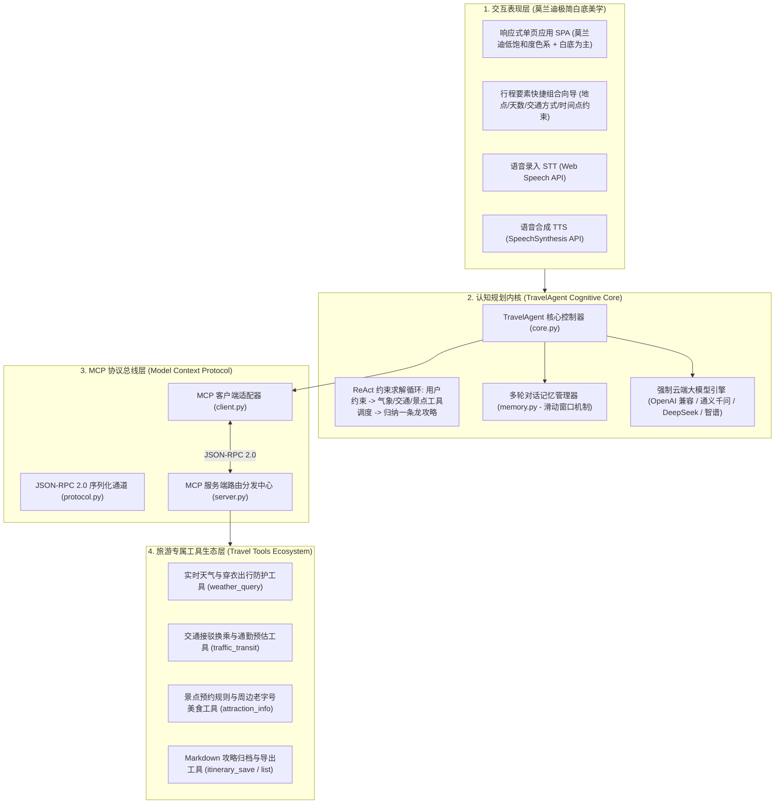
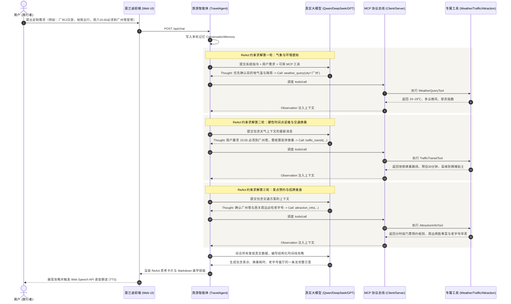

# TravelAgent 架构设计与协议技术白皮书

本文档详细记录 **广东工业大学 24 计科 6班三人团队** 构建的 **TravelAgent 智能旅游规划系统** 的总体架构、Model Context Protocol (MCP) 规范落地、ReAct 约束求解循环及莫兰迪白底美学工程设计。

---

## 一、 系统总体架构设计

TravelAgent 专注于**旅游定制专属垂直领域**，杜绝无意义的功能杂糅，建立在严密的软件工程分层体系之上：

---

## 二、 核心约束求解与 ReAct 执行时序

针对用户提出的【地点】、【交通方式】及【特定时间点必须在什么地方】的复合需求，智能体执行精准的倒推规划：

---

## 三、 强制接入真实在线大模型的安全规范

1. **彻底杜绝伪离线欺骗**：
   在 `llm_client.py` 中移除任何预设死数据的规则模板，当 `api_key` 为空或无效时，系统直接以结构化 HTTP 400 拦截请求并给出引导，确保智能体的生成富有创造力、温度和真实逻辑推理能力。
2. **零泄漏安全存储**：
   用户填入的 API Key 仅保存在当前运行服务内存与本地浏览器 Session 中，绝不回传任何第三方，且前端界面展示时统一做脱敏遮蔽（如 `sk-***abcd`）。
