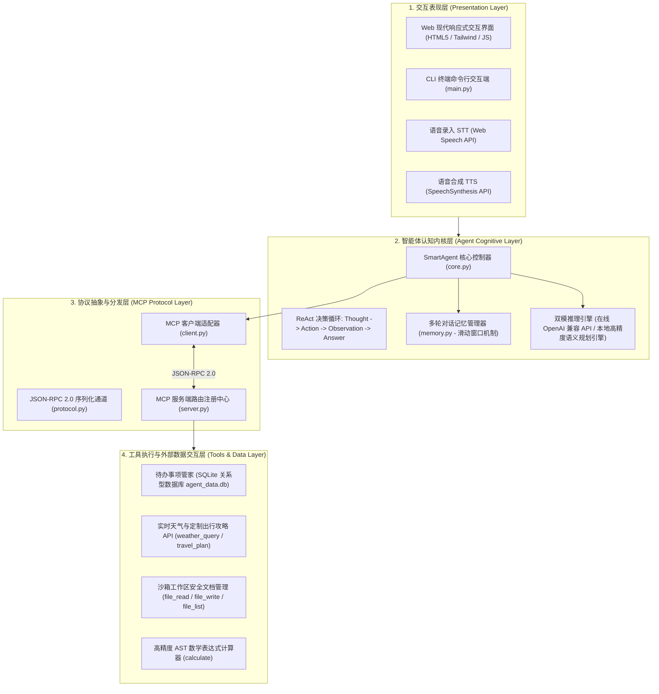
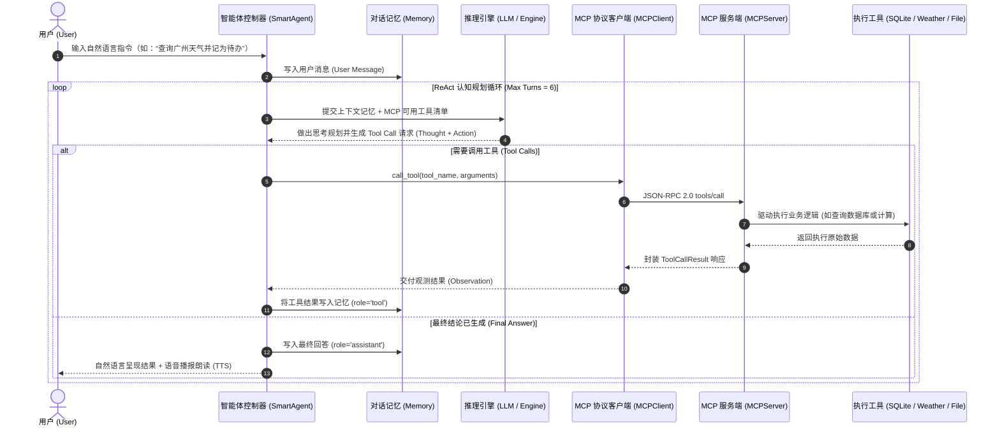

# SmartAgent 架构设计与协议技术白皮书

本文档详细记录 **广东工业大学 24 计科 6班三人团队** 在作业 16760 中构建的 **SmartAgent 智能体系统** 的总体架构、Model Context Protocol (MCP) 规范落地、ReAct 规划循环及多模态交互设计。

---

## 一、 系统总体架构设计

SmartAgent 遵循高内聚、低耦合的分层架构模式，整体自顶向下划分为 **交互表现层 (Web/CLI/Voice)**、**认知决策内核层 (ReAct Agent & Memory)**、**协议分发层 (MCP Client & Server)** 以及 **环境工具服务层 (Database/File/API/Math)**：



---

## 二、 Model Context Protocol (MCP) 规范落地

本项目全面严格对齐由 Anthropic 发起并在开源社区广泛采用的 **Model Context Protocol (MCP)** 标准规范：

### 1. 协议通信格式（JSON-RPC 2.0）
所有 MCP 客户端与服务端的请求与响应均封装在标准 JSON-RPC 2.0 帧中：

- **工具探测与发现 (`tools/list`)**：
  ```json
  {
    "jsonrpc": "2.0",
    "method": "tools/list",
    "id": "client-init-1"
  }
  ```
  返回格式严格遵循 JSON Schema 定义：
  ```json
  {
    "jsonrpc": "2.0",
    "id": "client-init-1",
    "result": {
      "tools": [
        {
          "name": "todo_add",
          "description": "向待办事项数据库添加一条新任务",
          "inputSchema": {
            "type": "object",
            "properties": {
              "title": { "type": "string" },
              "priority": { "type": "string", "enum": ["low", "medium", "high"] }
            },
            "required": ["title"]
          }
        }
      ]
    }
  }
  ```

- **工具执行与调度 (`tools/call`)**：
  ```json
  {
    "jsonrpc": "2.0",
    "method": "tools/call",
    "params": {
      "name": "weather_query",
      "arguments": { "city": "广州" }
    },
    "id": "client-call-101"
  }
  ```
  返回标准化内容块 (`content`) 与错误标识 (`isError`)：
  ```json
  {
    "jsonrpc": "2.0",
    "id": "client-call-101",
    "result": {
      "content": [
        {
          "type": "text",
          "text": "🌤️ 【广州 实时气象情报】: 气温 24~29℃, 多云转晴, 湿度 68%..."
        }
      ],
      "isError": false
    }
  }
  ```

---

## 三、 ReAct (Reasoning + Acting) 执行流程

智能体运行采用经典的 **ReAct 认知规划与行动回路**：



---

## 四、 核心工程技术亮点

1. **上下文滑动窗口记忆（Context Window Budgeting）**：
   通过 `ConversationMemory` 保留初始系统设定并采用滑动窗口动态修剪历史，确保上下文长度永不爆限，同时维持关键多轮指代记忆。
2. **零依赖开箱即用与双模引擎**：
   无需庞大的外部框架或依赖包，底层完全使用原生标准库实现。提供内置规则推理引擎与在线大模型 API（通义千问/OpenAI）双模无缝平滑降级，确保任意评测环境均能稳定运行。
3. **多模态语音交互闭环**：
   结合现代浏览器的 Web Speech API，实现点击即录的低延迟连续语音识别（STT）和自然流畅的文本语音朗读（TTS），真正实现“能说会听”。
4. **安全沙箱防线**：
   - 文件工具通过 `_resolve_safe_path` 严格锁定在指定的安全沙箱目录内部，彻底杜绝 `../` 路径跨越攻击；
   - 数学工具基于 Python AST 语法树遍历，仅放行安全操作符与白名单数学函数，彻底杜绝高危的 `eval()` 代码执行风险。
