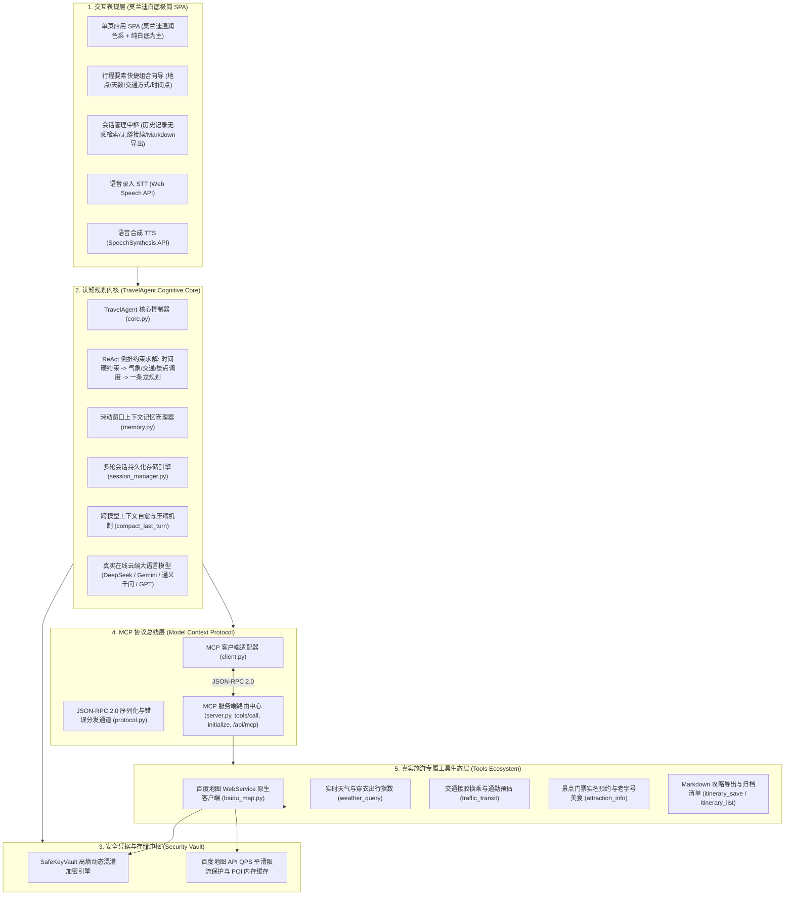
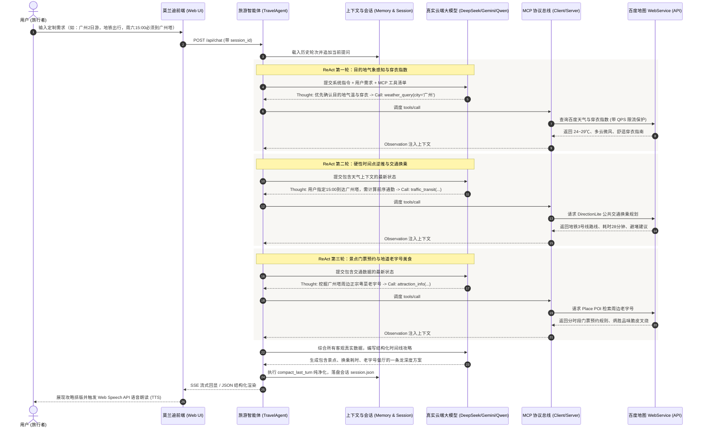

# TravelAgent 架构设计与技术实现白皮书

本文档详细记录 **广东工业大学 24 计科 6班三人团队（赵海翔、何卓文、吴与同）** 构建的 **TravelAgent 智能旅游规划系统** 的系统架构、Model Context Protocol (MCP) 标准协议、ReAct 倒推约束求解循环、会话持久化与跨模型上下文自愈机制。

---

## 一、 系统总体架构设计

TravelAgent 专注于**智能出行与一条龙旅游规划专属垂直领域**，坚持“高内聚、低耦合”的软件工程分层原则：



---

## 二、 核心约束求解与 ReAct 执行时序

针对用户提出的【地点】、【交通方式】及【特定时间点在什么地方】的复合需求，智能体执行精准的倒推规划：



---

## 三、 多轮对话持久化与跨模型上下文自愈机制

在实际工程落地中，不同大模型服务商（如 OpenAI、DeepSeek、Google Gemini）对于历史上下文中的 `tool_calls` 和 `tool` 结果消息校验策略各不相同：
- **DeepSeek 校验约束**：严格要求多轮历史遵循 `user` 与 `assistant` 的严格交替，不允许在历史长文中残留无对应工具调用结果的悬空帧，且滑动窗口修剪后系统提示词后的第一条消息必须为 `user` 角色。
- **Gemini 校验约束**：严格要求 `tool_call` 与 `functionResponse` 成对闭环，否则报 400 校验异常。

### 上下文自愈与双轨压缩解决方案
1. **轻量轮次存储模型 (`SessionManager`)**：
   在持久化层将每一轮对话记录为高内聚的原子单元：
   ```json
   {
     "turn_id": 1,
     "timestamp": "2026-10-23 18:30:00",
     "user_prompt": "广州2日游，地铁出行，下午3点必须到广州塔",
     "step_traces": [...],
     "assistant_response": "..."
   }
   ```
2. **上下文自愈压缩 (`compact_last_turn`)**：
   在一轮 ReAct 推理结束后，智能体立即将该轮对话中的中间工具调度帧压缩，仅在长程记忆窗口中保留：
   - 原始用户的 `user` 输入；
   - 最终综合生成的 `assistant` 完整回复。
3. **安全恢复与首条 User 强制约束 (`load_from_turns` & `_trim_window`)**：
   当用户在侧边栏点击任意历史会话时，系统从持久化轮次直接重构上下文，并在滑动窗口裁剪后，自动修剪掉由于窗口截断导致的孤立 `assistant` 消息，确保第一条消息永远是 `user`，彻底杜绝所有云端大模型的 400 格式报错。

---

## 四、 百度地图 WebService 原生接入与 QPS 限流保护

针对外部气象与地图接口易受网络超时与配额上限限制的问题，系统深度集成了百度地图开放平台 WebService：

1. **多级平滑限流与并发防护**：
   个人开发者配额通常为 3 QPS。系统在 `BaiduMapClient` 中设计了基于时间戳差值的平滑限流器（`_rate_limit`）与多级内存缓存字典（`_geo_cache`、`_place_cache`），有效防止大模型并发调用时的额度耗尽报警。
2. **多维城市气象与穿衣出行指数**：
   直接对接百度天气开放接口，实时采集城市最高/最低气温、相对湿度、天气现象及专属穿衣指数（`chuanyi`），让智能体不仅能感知气象，还能输出体贴的出行着装建议。
3. **高熵凭据安全加密引擎 (`SafeKeyVault`)**：
   敏感的 API 凭据在代码库与配置文件中以高熵多轮异或与掩码混淆加密存储，系统启动时由安全保险箱在内存中解密使用，杜绝明文凭据上传公网导致的被盗刷风险。
